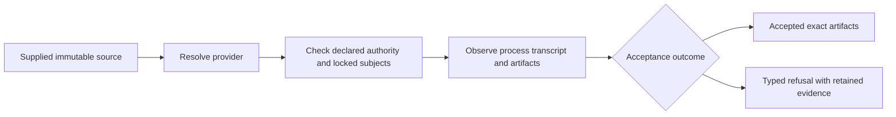
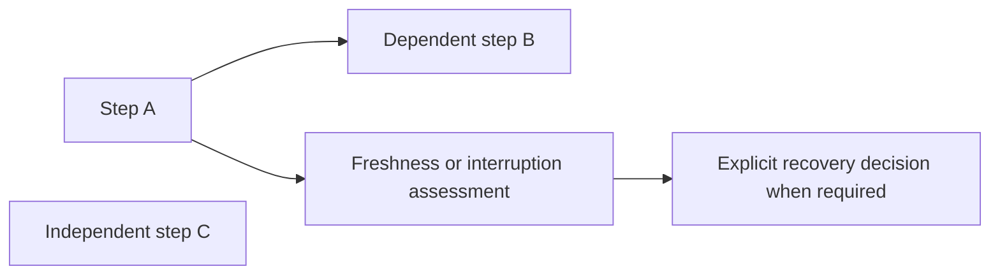

# Browse Flow's scenario evidence

## Publishing workflow source guides

The same local page now has a separate **Load publishing workflow guides**
control and search. Its [versioned source catalog](showcase/workflows.json)
covers the static publication preset, local AI preparation, tool-free video
folder preview, Sonic descriptions, manual-SRT pilot and publishing audio report.
Each guide links a pinned public source revision and owning issue/PR, with explicit
input/output intent, stage owners, prerequisites and remaining gates. The catalog
is a dated source snapshot; it does not query current PR, release or host status.

Guide counts are derived from that loaded catalog and remain separate from
canonical scenario counts and selected execution reports. Guides cannot claim
runtime qualification or observed executions, even if supplied through the local
file picker. They do not become provider capability, installation or acceptance
evidence. Human review, native/resource/model/platform qualification and actual
publishing remain separate work. The new parser rejects unknown records,
duplicate IDs, traversing source references and nonallowlisted links. Values are
rendered as text nodes; source links are not fetched automatically. The existing
same-origin/no-upload CSP, bounded reads and local report states remain intact.

Three source-guide model cases are authored, uncompiled/unrun. No browser,
Node/test/build/dependency/schema/docs/drift/product/native/provider/SDK/CLI or CI
execution occurred. Rendering/accessibility qualification stays deferred to #88;
there is no new paid CI, runtime engine, telemetry or publication authority.

The [scenario showcase](showcase/index.html) is a local, read-only documentation
browser for the current synthetic catalogs and indexed contract examples. Search
by stable scenario ID, expected outcome, recipe or recovery classification, filter
families, and expand expected typed traces without opening Rust source.

IDs and counts come directly from the selected canonical JSON. No duplicated
scenario registry or frozen total is maintained by the page. Loading source
recipes does not run tests, launch providers, build the suite or produce evidence.
The showcase source is authored and unqualified; browser/model checks and full
documentation qualification are deferred to [flow #88](https://github.com/egohygiene/flow/issues/88).

## Open a local checkout

When local viewing is desired, serve the checkout root with the standard Python
tooling already used by Flow. This is an explicit local viewer command, not a
product Flow CLI or test command; it is not run by opening the Markdown.

```console
python3 -m http.server 8000 --bind 127.0.0.1 --directory .
```

Open <http://127.0.0.1:8000/docs/integrations/showcase/> in a modern browser and
choose **Load repository catalogs**. The page fetches only these same-origin
source files after that explicit action:

- [Acceptance catalog](../../tests/fixtures/acceptance-scenarios.v1.json):
  resolution, contract, artifact, provider and privacy recipes.
- [Lifecycle catalog](../../tests/fixtures/lifecycle-scenarios.v1.json):
  durable execution, stale state, recovery, authority and cleanup recipes.
- [Canonical example index](../../contracts/fixtures/scenarios/canonical-digests.v1.json)
  and its explicitly indexed scenario-manifest examples.

The JSON picker can instead select copied catalogs, manifest examples or existing
normalized report files. It reads them in the browser; filenames are display
labels and never become network locators. Each document is bounded to 8 MiB, with
at most eight selected files/32 MiB per selection. No data is uploaded and no
report is fetched automatically. Clear loaded data removes the current view.
Serving is needed for browser modules; opening `index.html` as `file://` is not
the supported path. No package install, frontend build or paid CI is required.

## Read the states honestly

| Display | Meaning |
| --- | --- |
| Source recipes / expected outcome | Authored test intent, including expected refusal; no execution observation |
| `unavailable` | No report supplied for this catalog |
| `catalog-mismatch` | A supplied report describes different catalog bytes/family; do not call it current |
| `incomplete-or-conflicting` | Report membership, status or outcomes disagree with the selected catalog |
| `source-unconfirmed` | Report declares a pass matching these catalog bytes; present implementation, freshness, authenticity and native receipt validity are unconfirmed |

The viewer displays the exact raw catalog/report SHA-256 and, when available,
the report's recorded `source_identity.digest` and toolchain declaration. That
source digest names the report's content-addressed test-source inventory; the
native reports do not provide an authenticated Git commit or execution time.
The page never invents one or upgrades an unsigned report into current verified
evidence. It performs bounded presentation checks, not the native report
validators. Missing or stale evidence stays visible. Existing
[acceptance](acceptance-scenarios.md) and [lifecycle](lifecycle-scenarios.md)
drivers own actual receipt validation and source inventory checks.

## Representative paths and their text equivalents



Text equivalent: resolve the selected provider, check authority and locked
subjects, observe execution/artifacts, then assess acceptance. Process exit zero
or a declaration alone cannot select the accepted branch. A resolution-only
success such as `scenario:acceptance-resolution-compatible` still has
`accepted: false`; `scenario:acceptance-resolution-missing-provider` is an
expected unsupported outcome. Browse their exact current catalog declarations.



Text equivalent: B depends on A; C is independent. Staleness or interruption
requires the recipe's recorded assessment/recovery policy. The page displays
ordered expected snapshots and classifications for cases such as
`scenario:lifecycle-completed-restart`, `scenario:lifecycle-cancel-before-launch`
and `scenario:lifecycle-effect-stale-authority`. It does not execute recovery or
infer exactly-once effects, hardware crash behavior or real-provider support.

## Keep the presentation current

Edit the canonical catalogs through their normal fixture review. Reloading the
page reads the changed rows, expected traces, budgets and gaps directly, without
a generated copy or refreshed count. Unknown catalog/report versions refuse.
The contract-example index supplies only examples that it explicitly names;
its declared canonical digests remain distinct from raw file hashes shown here.

The optional pure model regression command, for a later authorized check session
with Node already available, is:

```console
node --test tools/test_scenario_showcase.mjs
```

Three focused tests are authored, uncompiled/unrun; no browser, generator,
validator, provider or CI check was executed for this checkpoint. No Node
dependency or CI workflow is added. Later qualification should exercise keyboard
navigation, narrow screens, source catalog changes, missing/mismatched/partial
reports and text-only rendering alongside the existing native validators.
