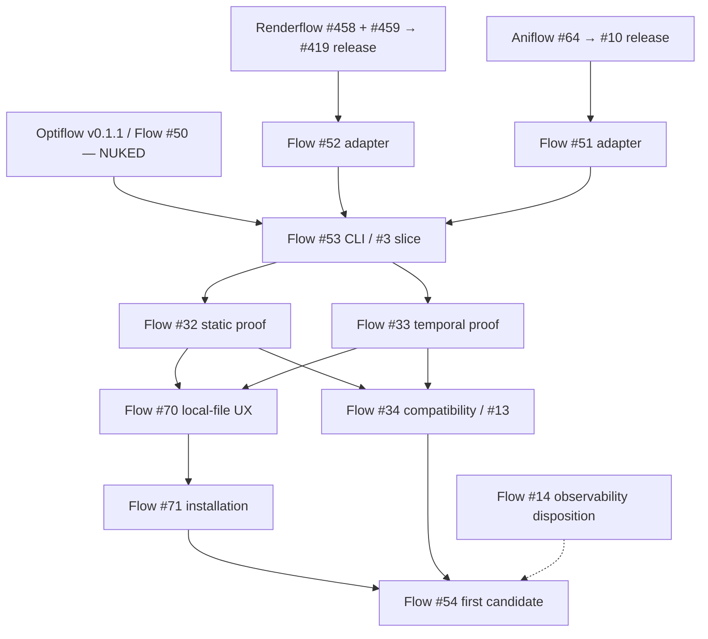

# Flow suite roadmap to completion

**Current snapshot: October 28, 2026.** All 16 pull requests open at the start of
this refresh have merged, followed by Optiflow #151's corpus-lock binding repair.
All four repositories have zero open PRs at this observation. Implementation
merges do not establish native qualification or publish a supported release.

Start with the [practical finish plan](flow-suite-finish-plan.md) for the next
bounded milestones, or the [continuation handoff](../work/11/HANDOFF.md) to resume
work. [Flow #11](https://github.com/egohygiene/flow/issues/11) owns this maintained
suite view; linked issues own acceptance, and [root ROADMAP](../../ROADMAP.md)
retains strategic horizons.

## Diagram and scope

- **[Full zoomable atlas: all 175 nodes](flow-suite-completion.svg)** — completed
  work remains visible as **NUKED**, alongside current and future work.
- [Full Mermaid dependency source](flow-suite-completion.mmd) — 232
  relationships, separating required prerequisites from scoped links and order.
- [Status snapshot](flow-suite-status.json) — exact observed heads, issue
  states, notes and source links.
- [Original September 27 diagram](archive/flow-suite-dependencies-2026-09-27.mmd)
  — unchanged. The October 6 maintained atlas remains in Git history; the
  [October 15 provider note](flow-suite-execution-order-2026-10-15.md) remains
  explicitly historical.


All **150 previously tracked nodes and 205 relationships** remain. This refresh
adds **25 issue nodes and 27 scoped or required relationships**, retaining all
**80 original nodes**. The inventory now contains **168 issues: 71 NUKED and
97 open**, plus **seven Optiflow horizons**. All currently open issues in the
four repositories are included, as are issues newly created since the previous
snapshot, including completed checkpoints. Selected earlier foundations remain
for context; this is not a census of every historical closed issue.

| Repository | Open issues | NUKED issue nodes | Open PRs | Published release |
| --- | ---: | ---: | ---: | --- |
| Flow | 31 | 10 | 0 | None |
| Renderflow | 27 | 6 | 0 | None |
| Optiflow | 13 | 9 | 0 | Read-only v0.1.1 |
| Aniflow | 26 | 46 | 0 | None |
| **Total** | **97** | **71** | **0** | |

Parents and children have different sizes; counts are **not a completion
percentage**. Most recent source work is already merged, while substantial
qualification and release work remains. The full backlog is larger than the
finite route to trying the tools.

**NUKED** means a bounded GitHub issue is closed as completed. It does not finish
its parent, platform or release. **IN PROGRESS** means implementation remains
even though useful source checkpoints have merged. **CHECKS / RELEASE OWED**
means authored source still owes acceptance, native proof or shipping gates.
**BLOCKED** retains declared prerequisites. **PARENT OPEN** retains umbrella
acceptance. **OPTIONAL** is outside the first baseline, not abandoned.
**EXTERNAL GATE** retains upstream ownership; **FUTURE HORIZON** has no invented
issue number. The atlas groups work; the relationship table below owns edge
meaning.

## What is usable, authored and still missing

| Project | Current boundary | Next practical milestone |
| --- | --- | --- |
| Flow | Merged library/kernel, extension contracts, durable state and native read-only Optiflow adapter. No supported product CLI or Flow release. | Released Renderflow/Aniflow adapters, CLI, installed workflows, local-file UX and first integration candidate. |
| Renderflow | Publication, creative forest, timed-text/speech and localized-composition source is merged. Native execution and first immutable release remain unqualified. | Finish #458/#459 acceptance, qualify the narrow publication profile and publish #419, then Flow #52. |
| Optiflow | Published v0.1.1 supports read-only inventory/review. PNG candidates and transaction foundations are newer source. Video planning/probing/bounds are partial source. | Finish bounded video candidates in #146 for a small hands-on trial; independently finish native transaction and PNG release gates. |
| Aniflow | Temporal/audio foundations, source recipe, target selection, upscale/import, master/delivery and synthetic demo source is merged. No published release. | Finish selected entry/delivery gaps, qualify through #64, release #10 and the selected music-video profile #40. |

The Flow extension seam supports locally supplied or community implementations
through explicit manifests, capabilities and exact locks; a public CLI,
installed-provider compatibility and distribution remain separate work.
Reusable profiles declare selected steps and order; they consume provider
contracts instead of duplicating provider engines. Flow #78 retains the AMV
preset and #70 the local-file experience. Optional AI belongs to Flow #80 and
its provider issues, without making model use a baseline requirement.

Three finish lines stay distinct:

1. **First useful trials and installed suite:** bounded provider capabilities,
   qualified immutable releases, Flow adapters/CLI, static and temporal proofs,
   local-file UX, install evidence and Flow #54. A developer source trial can
   precede a supported release if it is labelled honestly.
2. **Stable supported suite:** chosen capability matrix, provider audits and
   remediation, Flow #12 audit, clean-install evidence and #72; close #11 last
   with explicit owned dispositions for deferred scope.
3. **Full retained product backlog:** optional profiles, creator features,
   observability expansion and Optiflow's longer-term horizons. These do not
   automatically become prerequisites for the first useful trial.

## Route to the first installed Flow suite



Flow #53 declares all three adapters as dependencies, while its acceptance
allows static proof first and the temporal route when Aniflow is released.
Staged implementation is possible; closing #53 still needs an explicit
disposition of its declared #51 dependency. The completed durable foundations
do not remove installed-provider proof. #54 also keeps its direct #3/#34/#70/#71
gates. Observability #15's proposed contract merged in PR #86; ADR acceptance,
pilot conformance and the parent #14 disposition remain separate.

## Optiflow: getting to a folder of smaller videos

[Optiflow #146](https://github.com/egohygiene/optiflow/issues/146) is the direct
route to the user's video goal. Its planner, FFmpeg observer and bounded pipe/
deadline source have merged. The next implementation order is aggregate
memory/scratch policy, independent decode/preservation/lossy acceptance,
versioned candidate publication, then a small hands-on trial. Recursive
one-file-at-a-time processing and video-specific qualified replacement/disposal
follow. This is not yet an accepted video optimizer or a supported destructive
folder command.

Separately, #111's same-volume Mac/APFS source merged in PR #122; descriptor ACL,
cross-volume, finalization and native evidence remain. #93 owns qualified dedup
release gates, #95 restorable PNG replacement, and #121 explicitly selected
serial original disposal for the qualified **PNG** subset. #121 is not the
video batch implementation. One-file-at-a-time still needs candidate/scratch
headroom; zero additional storage is not promised.

#136's corpus-lock repair, including PR #151 after the dependency sweep, and
#137's temporary-root fix are merged source with qualification still owed.
#65 remains the broader corpus owner. Use exact required fixture subsets,
without turning the entire corpus or seven future horizons into a blanket
prerequisite for a bounded video trial.

## Aniflow and Renderflow follow-through

Aniflow #36 import/repair and #104 audio-registration preparation are now
**NUKED**. #111 retains prior-upscaled spatial-index entry; #35/#112 retain
selected audio-tail, loudness and delivery-metadata work; #113 owns the exact
validated final-video handoff. #37/#38/#24 retain recovery, selected toolchain
and corpus proof. #64, #10 and #40 own qualification and releases before Flow
#51/#75/#78 can advertise their corresponding installed workflows.

The current Aniflow source route is deliberately narrow: supported zero-origin
CFR MP4/MOV, progressive 8-bit BT.709, square unrotated pixels and selected AAC
or no audio. VFR/HDR, unsupported offsets and long tails, and derived RIFE clocks
remain refused or separately owned. RIFE #110, manual review modes #107,
subtitles #108, signed identity #109, restoration #106 and AI #116 remain
selected extensions; their existence does not finish the core release.

Renderflow #422–#428/#440 source and #430's original-export gaps have merged;
their issues retain composed/native acceptance. #429 retains exact optional
tool/model readiness and #406 broader typography/interchange/visual proof.
#458/#459 and #419 form the narrow provider-release path. The full creative
forest, larger corpus #412/#413, editorial #379/#378, Sonic DNA #397, slides
#350, briefings #349, AI #456 and HTTP #420 remain visible without all becoming
first-publication requirements.

## Observability, audits and preserved relationships

Flow #15 now has a merged proposed privacy/stream contract. Contract disposition
precedes #16's local CLI pilots, #17's OTel proof and #18's package decision.
#19 exists only if a package is selected; #20–#22 retain migration, diagnostics
and help. No exporter, instrumentation or conformance is inferred from the
contract merge. #62 remains an independent scenario-documentation lane.

Renderflow #409, Optiflow #61 and Aniflow #17 audits precede Flow #12; then #72
and finally #11 reconcile supported scope and owned deferrals. Provider audits
do not wait for Flow #11 to close. ADR/upstream governance issues remain
tracked without becoming new prerequisites for ordinary product coding.

All 205 prior relationships are retained verbatim. A solid edge means a declared
prerequisite or closeout gate; a dotted **scoped** edge applies only to the
labelled selected capability, fixture subset or evidence tranche. A dotted
**sequence** edge recommends work order and does not invent a blocker. New
links use the same semantics. For example, #111 → #146 concerns later native
replacement, not video candidate authoring; #146 → Flow #70 applies only after
a released video capability and appropriate adapter exist.

## Complete issue and horizon inventory

“Original” marks September 27 nodes. “Added” includes newer issues and earlier
foundations retained for context. Every node has one entry; linked issues retain
their full titles and acceptance.

### Flow

41 nodes; 10 NUKED; 31 open issues.

| Issue / horizon | Group | Status | Origin | Remaining scope / evidence |
| --- | --- | --- | --- | --- |
| [flow #23](https://github.com/egohygiene/flow/issues/23) — Extension execution seam | Foundations | **NUKED** | Added | Completed bounded foundation; evidence remains linked in the issue. |
| [flow #25](https://github.com/egohygiene/flow/issues/25) — Provider process boundary | Foundations | **NUKED** | Added | Completed bounded foundation; evidence remains linked in the issue. |
| [flow #28](https://github.com/egohygiene/flow/issues/28) — Scenario contract | Foundations | **NUKED** | Added | Completed bounded foundation; evidence remains linked in the issue. |
| [flow #29](https://github.com/egohygiene/flow/issues/29) — Hermetic provider kit | Foundations | **NUKED** | Added | Completed bounded foundation; evidence remains linked in the issue. |
| [flow #30](https://github.com/egohygiene/flow/issues/30) — Acceptance scenarios | Foundations | **NUKED** | Added | Completed bounded foundation; evidence remains linked in the issue. |
| [flow #49](https://github.com/egohygiene/flow/issues/49) — Durable run state | Foundations | **NUKED** | Added | Completed bounded foundation; evidence remains linked in the issue. |
| [flow #31](https://github.com/egohygiene/flow/issues/31) — Recovery and authority proof | Foundations | **NUKED** | Added | Completed bounded foundation; evidence remains linked in the issue. |
| [flow #50](https://github.com/egohygiene/flow/issues/50) — Optiflow read-only | Foundations | **NUKED** | Original | Merged read-only Optiflow adapter; mutation is a separate lane. |
| [flow #82](https://github.com/egohygiene/flow/issues/82) — Current source navigation | Foundations | **NUKED** | Added | Completed documentation reconciliation in PR #85. |
| [flow #81](https://github.com/egohygiene/flow/issues/81) — Saved receipt validation | Foundations | **NUKED** | Added | Completed in PR #84 with focused Linux proof; broader qualification remains #34. |
| [flow #51](https://github.com/egohygiene/flow/issues/51) — Aniflow adapter | First usable install | **BLOCKED** | Original | Needs Aniflow #10 immutable release. |
| [flow #52](https://github.com/egohygiene/flow/issues/52) — Renderflow adapter | First usable install | **BLOCKED** | Original | Needs Renderflow #419 immutable release. |
| [flow #53](https://github.com/egohygiene/flow/issues/53) — CLI | First usable install | **BLOCKED** | Original | Released adapters into doctor / plan / run / status / resume. |
| [flow #3](https://github.com/egohygiene/flow/issues/3) — Vertical slice | First usable install | **PARENT OPEN** | Original | Core exists; real released-provider vertical slice remains. |
| [flow #32](https://github.com/egohygiene/flow/issues/32) — Static proof | First usable install | **BLOCKED** | Original | Prove static publication using installed release artifacts. |
| [flow #33](https://github.com/egohygiene/flow/issues/33) — Temporal proof | First usable install | **BLOCKED** | Original | Prove temporal workflows using installed release artifacts. |
| [flow #34](https://github.com/egohygiene/flow/issues/34) — Clean-room gate | First usable install | **BLOCKED** | Original | Clean-room compatibility, bounded tiers and regressions. |
| [flow #13](https://github.com/egohygiene/flow/issues/13) — Fixture parent | First usable install | **PARENT OPEN** | Original | Earlier fixture children done; released-provider proofs remain. |
| [flow #70](https://github.com/egohygiene/flow/issues/70) — Local-file UX | First usable install | **BLOCKED** | Original | Profiles select step order, including optimization before or after generation; released adapters remain required. |
| [flow #71](https://github.com/egohygiene/flow/issues/71) — Suite package | First usable install | **BLOCKED** | Original | Installable suite bundle and honest package/channel names. |
| [flow #54](https://github.com/egohygiene/flow/issues/54) — First release | First usable install | **BLOCKED** | Original | First immutable candidate; observability needs explicit disposition. |
| [flow #10](https://github.com/egohygiene/flow/issues/10) — Comic everything | Workflow extensions | **BLOCKED** | Original | Comic/localization tree; retained, reviewed upscale candidates. |
| [flow #73](https://github.com/egohygiene/flow/issues/73) — Exact dedup adapter | Workflow extensions | **BLOCKED** | Original | Only after qualified Optiflow v0.2 (#93). |
| [flow #74](https://github.com/egohygiene/flow/issues/74) — PNG adapter | Workflow extensions | **BLOCKED** | Original | Only after PNG replacement release (#95) and #73. |
| [flow #75](https://github.com/egohygiene/flow/issues/75) — Music-video adapter | Workflow extensions | **BLOCKED** | Original | Only after Aniflow music-video release (#40). |
| [flow #78](https://github.com/egohygiene/flow/issues/78) — Reusable AMV preset | Workflow extensions | **BLOCKED** | Added | Selectable AMV steps; consumes #75, not a second engine. |
| [flow #62](https://github.com/egohygiene/flow/issues/62) — Scenario docs | Workflow extensions | **PLANNED** | Original | Visual scenario catalog; #28/#30 prerequisites complete. |
| [flow #80](https://github.com/egohygiene/flow/issues/80) — Optional AI runtimes | Workflow extensions | **OPTIONAL** | Added | Existing provider routing and local model preparation; deterministic operation remains available. |
| [flow #15](https://github.com/egohygiene/flow/issues/15) — Signal contract | Observability | **CHECKS / RELEASE OWED** | Original | Proposed profile merged in PR #86; ADR disposition and conformance remain. |
| [flow #16](https://github.com/egohygiene/flow/issues/16) — Two CLI pilots | Observability | **BLOCKED** | Original | Acceptance remains in the linked issue. |
| [flow #17](https://github.com/egohygiene/flow/issues/17) — OTel proof | Observability | **BLOCKED** | Original | Acceptance remains in the linked issue. |
| [flow #18](https://github.com/egohygiene/flow/issues/18) — Crate decision | Observability | **BLOCKED** | Original | Decide whether a shared package is justified. |
| [flow #19](https://github.com/egohygiene/flow/issues/19) — Package if selected | Observability | **OPTIONAL** | Original | Only if #18 selects a shared package. |
| [flow #20](https://github.com/egohygiene/flow/issues/20) — Suite migration | Observability | **BLOCKED** | Original | Acceptance remains in the linked issue. |
| [flow #21](https://github.com/egohygiene/flow/issues/21) — Diagnostics | Observability | **BLOCKED** | Original | Acceptance remains in the linked issue. |
| [flow #22](https://github.com/egohygiene/flow/issues/22) — Help | Observability | **BLOCKED** | Original | Acceptance remains in the linked issue. |
| [flow #14](https://github.com/egohygiene/flow/issues/14) — Obs parent | Observability | **PARENT OPEN** | Original | Full observability or explicit first-release disposition. |
| [flow #9](https://github.com/egohygiene/flow/issues/9) — ADR | Stable-suite finish | **EXTERNAL GATE** | Original | External ADR platform gates; not a product-code blocker. |
| [flow #12](https://github.com/egohygiene/flow/issues/12) — audit | Stable-suite finish | **BLOCKED** | Original | Provider audits first, then suite reconciliation and remediation. |
| [flow #72](https://github.com/egohygiene/flow/issues/72) — Stable suite | Stable-suite finish | **BLOCKED** | Original | Stable releases, compatibility lock and clean-install proof. |
| [flow #11](https://github.com/egohygiene/flow/issues/11) — completion | Stable-suite finish | **PARENT OPEN** | Original | Close last with evidence and explicit post-v1 dispositions. |

### Renderflow

33 nodes; 6 NUKED; 27 open issues.

| Issue / horizon | Group | Status | Origin | Remaining scope / evidence |
| --- | --- | --- | --- | --- |
| [renderflow #415](https://github.com/egohygiene/renderflow/issues/415) — Ordered collection | Publication foundation | **NUKED** | Original | Ordered publication collections merged. |
| [renderflow #416](https://github.com/egohygiene/renderflow/issues/416) — Print PDF | Publication foundation | **NUKED** | Original | Print-interior PDF route merged. |
| [renderflow #417](https://github.com/egohygiene/renderflow/issues/417) — Fixed EPUB | Publication foundation | **NUKED** | Original | Fixed-layout EPUB route merged. |
| [renderflow #418](https://github.com/egohygiene/renderflow/issues/418) — EPUB validation | Publication foundation | **NUKED** | Original | EPUB validation merged; not publisher acceptance. |
| [renderflow #414](https://github.com/egohygiene/renderflow/issues/414) — EPUB parent | Publication foundation | **NUKED** | Original | EPUB parent closed; publication remains in #419. |
| [renderflow #419](https://github.com/egohygiene/renderflow/issues/419) — First provider release | Publication foundation | **CHECKS / RELEASE OWED** | Original | No published release. #458, #459 and exact-source installation proof remain. |
| [renderflow #459](https://github.com/egohygiene/renderflow/issues/459) — Current documentation | Publication foundation | **CHECKS / RELEASE OWED** | Added | Corrections merged; structural and link acceptance remains deferred. |
| [renderflow #458](https://github.com/egohygiene/renderflow/issues/458) — Locked qualification baseline | Publication foundation | **IN PROGRESS** | Added | Schema and Snap fixes merged; Cargo-produced lock, lint and platform qualification remain. |
| [renderflow #433](https://github.com/egohygiene/renderflow/issues/433) — Real-artifact gallery | Corpus and comic composition | **NUKED** | Added | Three-input real-artifact gallery merged. |
| [renderflow #412](https://github.com/egohygiene/renderflow/issues/412) — Adversarial corpus | Corpus and comic composition | **PARENT OPEN** | Original | Gallery exists; broader adversarial corpus remains. |
| [renderflow #413](https://github.com/egohygiene/renderflow/issues/413) — Comic fixtures | Corpus and comic composition | **PLANNED** | Original | Small synthetic comic pack; extend existing corpus. |
| [renderflow #406](https://github.com/egohygiene/renderflow/issues/406) — Localized composition | Corpus and comic composition | **IN PROGRESS** | Original | Six source checkpoints merged; broader typography, interchange and visual/native proof remain. |
| [renderflow #422](https://github.com/egohygiene/renderflow/issues/422) — Forest planner | Artifact forest | **CHECKS / RELEASE OWED** | Original | Cycle-safe planning source merged; execution qualification remains. |
| [renderflow #423](https://github.com/egohygiene/renderflow/issues/423) — Screenplay model | Artifact forest | **CHECKS / RELEASE OWED** | Original | Canonical model merged; contract and runtime qualification remain. |
| [renderflow #424](https://github.com/egohygiene/renderflow/issues/424) — Scripttool adapter | Artifact forest | **CHECKS / RELEASE OWED** | Original | Bounded Scripttool imports merged; reverse routes rejected; native/refusal proof remains. |
| [renderflow #425](https://github.com/egohygiene/renderflow/issues/425) — Afterwriting adapter | Artifact forest | **CHECKS / RELEASE OWED** | Original | PDF and analysis source merged; native and failure proof remains. |
| [renderflow #426](https://github.com/egohygiene/renderflow/issues/426) — PDF/text recovery | Artifact forest | **CHECKS / RELEASE OWED** | Original | Lossy recovery source merged; OCR, provider and review proof remains. |
| [renderflow #427](https://github.com/egohygiene/renderflow/issues/427) — Timed-text model | Artifact forest | **CHECKS / RELEASE OWED** | Original | Timed text and text exports merged; runtime qualification remains. |
| [renderflow #428](https://github.com/egohygiene/renderflow/issues/428) — Speech transcript | Artifact forest | **CHECKS / RELEASE OWED** | Original | Source merged; native, model and timing proof remains. |
| [renderflow #429](https://github.com/egohygiene/renderflow/issues/429) — Optional toolchain evidence | Artifact forest | **IN PROGRESS** | Original | Doctor source merged; exact assets, model readiness and qualification remain. |
| [renderflow #430](https://github.com/egohygiene/renderflow/issues/430) — Creative forest proof | Artifact forest | **CHECKS / RELEASE OWED** | Original | Original-export gaps filled in PR #455; composed CLI/SDK and released Flow proof remain. |
| [renderflow #421](https://github.com/egohygiene/renderflow/issues/421) — Creative forest parent | Artifact forest | **PARENT OPEN** | Original | Child source is largely merged; composed integration and qualification remain. |
| [renderflow #440](https://github.com/egohygiene/renderflow/issues/440) — Original-media time maps | Artifact forest | **CHECKS / RELEASE OWED** | Added | Explicit aligned subtitle and time-map source merged; native proof remains. |
| [renderflow #378](https://github.com/egohygiene/renderflow/issues/378) — Editorial agent | Additional product lanes | **OPTIONAL** | Original | Product extension paired with the #379 contract. |
| [renderflow #379](https://github.com/egohygiene/renderflow/issues/379) — Editorial profile | Additional product lanes | **OPTIONAL** | Original | Contract before editorial agent; separate from the first release. |
| [renderflow #350](https://github.com/egohygiene/renderflow/issues/350) — Slides | Additional product lanes | **OPTIONAL** | Original | Optional Slidev profile; provider/asset qualification owed. |
| [renderflow #397](https://github.com/egohygiene/renderflow/issues/397) — Sonic DNA profile | Additional product lanes | **OPTIONAL** | Original | Consumes Aniflow audio evidence; separate from the first provider release. |
| [renderflow #349](https://github.com/egohygiene/renderflow/issues/349) — Podcast | Additional product lanes | **OPTIONAL** | Original | Research-first briefings and optional audio derivatives. |
| [renderflow #420](https://github.com/egohygiene/renderflow/issues/420) — HTTP API | Additional product lanes | **OPTIONAL** | Original | Optional HTTP/job-service lane, outside first CLI release. |
| [renderflow #367](https://github.com/egohygiene/renderflow/issues/367) — Product roadmap | Additional product lanes | **PARENT OPEN** | Original | Product umbrella; forest, profiles and Flow proof remain. |
| [renderflow #456](https://github.com/egohygiene/renderflow/issues/456) — Publication AI summaries | Additional product lanes | **OPTIONAL** | Added | Source-grounded candidates using Flow #80's selected optional profiles. |
| [renderflow #405](https://github.com/egohygiene/renderflow/issues/405) — ADR | Renderflow closeout | **EXTERNAL GATE** | Original | External ADR platform gates remain. |
| [renderflow #409](https://github.com/egohygiene/renderflow/issues/409) — audit | Renderflow closeout | **BLOCKED** | Original | After active product/release work; before final Flow audit. |

### Optiflow

29 nodes; 9 NUKED; 13 open issues.

| Issue / horizon | Group | Status | Origin | Remaining scope / evidence |
| --- | --- | --- | --- | --- |
| [optiflow #88](https://github.com/egohygiene/optiflow/issues/88) — Filesystem corpus | Inspection and Linux transactions | **NUKED** | Added | Bounded filesystem corpus merged; #65 stays open. |
| [optiflow #89](https://github.com/egohygiene/optiflow/issues/89) — Read-only v0.1.1 | Inspection and Linux transactions | **NUKED** | Added | Signed read-only v0.1.1 published; no mutation authority. |
| [optiflow #90](https://github.com/egohygiene/optiflow/issues/90) — Approval and dry-run | Inspection and Linux transactions | **NUKED** | Added | Approval/dry-run implementation; unreleased transaction path. |
| [optiflow #91](https://github.com/egohygiene/optiflow/issues/91) — Linux quarantine | Inspection and Linux transactions | **NUKED** | Added | Linux quarantine implemented; not native Mac qualification. |
| [optiflow #106](https://github.com/egohygiene/optiflow/issues/106) — CI baseline repair | Inspection and Linux transactions | **NUKED** | Added | Bounded CI baseline repair complete; current checks not rerun. |
| [optiflow #92](https://github.com/egohygiene/optiflow/issues/92) — Linux recovery | Inspection and Linux transactions | **NUKED** | Added | Linux resume/restore/cleanup implemented. |
| [optiflow #96](https://github.com/egohygiene/optiflow/issues/96) — Linux finalization | Inspection and Linux transactions | **NUKED** | Added | Linux retained-copy finalization; not general source disposal. |
| [optiflow #146](https://github.com/egohygiene/optiflow/issues/146) — Video optimization | Video folder goal | **IN PROGRESS** | Added | Planner, probe and pipe bounds merged; memory/scratch, validation, candidates and folder work remain. |
| [optiflow #111](https://github.com/egohygiene/optiflow/issues/111) — Mac/APFS transactions | Mac and optimization | **IN PROGRESS** | Original | Same-volume source merged; descriptor ACL, cross-volume, finalization and native proof remain. |
| [optiflow #93](https://github.com/egohygiene/optiflow/issues/93) — Qualified dedup release | Mac and optimization | **CHECKS / RELEASE OWED** | Original | Native/disposable-volume recovery proof and v0.2 publication remain. |
| [optiflow #112](https://github.com/egohygiene/optiflow/issues/112) — PNG corpus | Mac and optimization | **NUKED** | Added | PNG/provider fixture tranche merged via PR #113. |
| [optiflow #94](https://github.com/egohygiene/optiflow/issues/94) — OxiPNG candidate | Mac and optimization | **NUKED** | Original | Producer merged; real OxiPNG/MSRV/native checks owed. |
| [optiflow #95](https://github.com/egohygiene/optiflow/issues/95) — PNG replacement | Mac and optimization | **BLOCKED** | Original | After #93 + #94; preserve restorable originals; v0.3. |
| [optiflow #121](https://github.com/egohygiene/optiflow/issues/121) — Serial low-space PNG | Mac and optimization | **IN PROGRESS** | Added | Policy preparation exists; recursive replacement, disposal, recovery and qualification remain. |
| [optiflow #65](https://github.com/egohygiene/optiflow/issues/65) — Media corpus | Mac and optimization | **PARENT OPEN** | Original | Broader media/compatibility/resource corpus remains. |
| [optiflow #137](https://github.com/egohygiene/optiflow/issues/137) — Mac fixture roots | Mac and optimization | **CHECKS / RELEASE OWED** | Added | Canonical-root fix merged; macOS/Linux regression proof remains. |
| [optiflow #136](https://github.com/egohygiene/optiflow/issues/136) — Corpus lock binding | Mac and optimization | **CHECKS / RELEASE OWED** | Added | Binding repair merged after dependency sweep; corpus/index execution remains. |
| [optiflow #133](https://github.com/egohygiene/optiflow/issues/133) — Evidence explanations | Optional evidence | **OPTIONAL** | Added | Optional AI over immutable evidence; separate from baseline compression. |
| [optiflow #115](https://github.com/egohygiene/optiflow/issues/115) — Release names | Optiflow closeout | **EXTERNAL GATE** | Added | Wait for a compatible published Relay naming contract. |
| [optiflow #60](https://github.com/egohygiene/optiflow/issues/60) — ADR | Optiflow closeout | **EXTERNAL GATE** | Original | External ADR platform gates remain. |
| [optiflow #61](https://github.com/egohygiene/optiflow/issues/61) — audit | Optiflow closeout | **BLOCKED** | Original | Audit after active work; not after Flow #11 closes. |
| [optiflow #135](https://github.com/egohygiene/optiflow/issues/135) — Optiflow completion ledger | Optiflow closeout | **PARENT OPEN** | Added | Tracks native transactions, PNG, video, qualification and retained follow-ons. |
| [v0.4 Image profiles](https://github.com/egohygiene/optiflow/blob/c5dbcd1761e810aea228389b8ba017acc97a411e/ROADMAP.md) | Future product horizons | **FUTURE HORIZON** | Added | Broader image conversions; needs bounded issue decomposition. |
| [v0.5 Audio/video optimization](https://github.com/egohygiene/optiflow/blob/c5dbcd1761e810aea228389b8ba017acc97a411e/ROADMAP.md) | Future product horizons | **FUTURE HORIZON** | Added | Concrete video subset now tracked in #146; broader horizon remains. |
| [v0.6 Perceptual relationships](https://github.com/egohygiene/optiflow/blob/c5dbcd1761e810aea228389b8ba017acc97a411e/ROADMAP.md) | Future product horizons | **FUTURE HORIZON** | Added | Similarity/containment horizon; exact dedup is narrower. |
| [v0.7 Collections and portable state](https://github.com/egohygiene/optiflow/blob/c5dbcd1761e810aea228389b8ba017acc97a411e/ROADMAP.md) | Future product horizons | **FUTURE HORIZON** | Added | Longer-term product scope; named implementation issues needed. |
| [v0.8 Policy and review UX](https://github.com/egohygiene/optiflow/blob/c5dbcd1761e810aea228389b8ba017acc97a411e/ROADMAP.md) | Future product horizons | **FUTURE HORIZON** | Added | Automation/review horizon; not implicit mutation authority. |
| [v0.9 Stable-contract beta](https://github.com/egohygiene/optiflow/blob/c5dbcd1761e810aea228389b8ba017acc97a411e/ROADMAP.md) | Future product horizons | **FUTURE HORIZON** | Added | Broader product qualification beyond current release gates. |
| [v1.0 macOS/Linux GA](https://github.com/egohygiene/optiflow/blob/c5dbcd1761e810aea228389b8ba017acc97a411e/ROADMAP.md) | Future product horizons | **FUTURE HORIZON** | Added | Reconcile supported scope before claiming full Optiflow completion. |

### Aniflow

72 nodes; 46 NUKED; 26 open issues.

| Issue / horizon | Group | Status | Origin | Remaining scope / evidence |
| --- | --- | --- | --- | --- |
| [aniflow #8](https://github.com/egohygiene/aniflow/issues/8) — Demucs | Audio foundations | **NUKED** | Original | Demucs implementation merged; native/model scope stays bounded. |
| [aniflow #42](https://github.com/egohygiene/aniflow/issues/42) — Audio analysis contract | Audio foundations | **NUKED** | Added | Bounded implementation complete; historical local evidence retained. Wider platform/release proof remains. |
| [aniflow #43](https://github.com/egohygiene/aniflow/issues/43) — Offline technical inspection | Audio foundations | **NUKED** | Added | Bounded implementation complete; historical local evidence retained. Wider platform/release proof remains. |
| [aniflow #44](https://github.com/egohygiene/aniflow/issues/44) — Loudness, peak and silence | Audio foundations | **NUKED** | Added | Bounded implementation complete; historical local evidence retained. Wider platform/release proof remains. |
| [aniflow #55](https://github.com/egohygiene/aniflow/issues/55) — High-rate true peak | Audio foundations | **NUKED** | Added | Bounded implementation complete; historical local evidence retained. Wider platform/release proof remains. |
| [aniflow #45](https://github.com/egohygiene/aniflow/issues/45) — Stem lineage | Audio foundations | **NUKED** | Added | Bounded implementation complete; historical local evidence retained. Wider platform/release proof remains. |
| [aniflow #46](https://github.com/egohygiene/aniflow/issues/46) — Tempo, beat and key | Audio foundations | **NUKED** | Added | Bounded implementation complete; historical local evidence retained. Wider platform/release proof remains. |
| [aniflow #47](https://github.com/egohygiene/aniflow/issues/47) — Timed-text conversion | Audio foundations | **NUKED** | Added | Bounded implementation complete; historical local evidence retained. Wider platform/release proof remains. |
| [aniflow #48](https://github.com/egohygiene/aniflow/issues/48) — Offline transcription | Audio foundations | **NUKED** | Added | Bounded implementation complete; historical local evidence retained. Wider platform/release proof remains. |
| [aniflow #49](https://github.com/egohygiene/aniflow/issues/49) — Reviewed lyric alignment | Audio foundations | **NUKED** | Added | Bounded implementation complete; historical local evidence retained. Wider platform/release proof remains. |
| [aniflow #50](https://github.com/egohygiene/aniflow/issues/50) — MIDI candidates | Audio foundations | **NUKED** | Added | Bounded implementation complete; historical local evidence retained. Wider platform/release proof remains. |
| [aniflow #51](https://github.com/egohygiene/aniflow/issues/51) — Audio workflow handoff | Audio foundations | **NUKED** | Added | Bounded implementation complete; historical local evidence retained. Wider platform/release proof remains. |
| [aniflow #13](https://github.com/egohygiene/aniflow/issues/13) — Audio evidence | Audio foundations | **NUKED** | Original | Typed audio/lyrics/MIDI source merged; #64 owns residual checks. |
| [aniflow #32](https://github.com/egohygiene/aniflow/issues/32) — Temporal correctness | Temporal foundations | **NUKED** | Original | Temporal implementation merged; qualification owed to #64. |
| [aniflow #66](https://github.com/egohygiene/aniflow/issues/66) — Layered validation contracts | Temporal foundations | **NUKED** | Added | Bounded implementation merged; qualification remains under #64. |
| [aniflow #67](https://github.com/egohygiene/aniflow/issues/67) — Runtime validation gates | Temporal foundations | **NUKED** | Added | Bounded implementation merged; qualification remains under #64. |
| [aniflow #68](https://github.com/egohygiene/aniflow/issues/68) — Validation handoff | Temporal foundations | **NUKED** | Added | Bounded implementation merged; qualification remains under #64. |
| [aniflow #33](https://github.com/egohygiene/aniflow/issues/33) — Validation | Temporal foundations | **NUKED** | Original | Validation implementation merged; qualification owed to #64. |
| [aniflow #71](https://github.com/egohygiene/aniflow/issues/71) — Cache identity and ownership | Temporal foundations | **NUKED** | Added | Bounded implementation merged; qualification remains under #64. |
| [aniflow #72](https://github.com/egohygiene/aniflow/issues/72) — Cross-run reuse | Temporal foundations | **NUKED** | Added | Bounded implementation merged; qualification remains under #64. |
| [aniflow #73](https://github.com/egohygiene/aniflow/issues/73) — Cache controls and handoff | Temporal foundations | **NUKED** | Added | Bounded implementation merged; qualification remains under #64. |
| [aniflow #34](https://github.com/egohygiene/aniflow/issues/34) — Reuse and controls | Temporal foundations | **NUKED** | Original | Reuse/controls merged; qualification owed to #64. |
| [aniflow #75](https://github.com/egohygiene/aniflow/issues/75) — Corpus recipes | Temporal foundations | **NUKED** | Added | Bounded implementation merged; qualification remains under #64. |
| [aniflow #76](https://github.com/egohygiene/aniflow/issues/76) — Corpus consumers | Temporal foundations | **NUKED** | Added | Bounded implementation merged; qualification remains under #64. |
| [aniflow #77](https://github.com/egohygiene/aniflow/issues/77) — Corpus gates | Temporal foundations | **NUKED** | Added | Bounded implementation merged; qualification remains under #64. |
| [aniflow #24](https://github.com/egohygiene/aniflow/issues/24) — Media corpus and demos | Temporal foundations | **PARENT OPEN** | Original | Synthetic demonstration source merged; broader corpus and execution remain. |
| [aniflow #89](https://github.com/egohygiene/aniflow/issues/89) — Artifact-set identities | Temporal foundations | **NUKED** | Added | Bounded implementation merged; qualification remains under #64. |
| [aniflow #90](https://github.com/egohygiene/aniflow/issues/90) — Complete output-set execution | Temporal foundations | **NUKED** | Added | Bounded implementation merged; qualification remains under #64. |
| [aniflow #91](https://github.com/egohygiene/aniflow/issues/91) — Multi-artifact handoff | Temporal foundations | **NUKED** | Added | Bounded implementation merged; qualification remains under #64. |
| [aniflow #69](https://github.com/egohygiene/aniflow/issues/69) — Multiple artifacts per port | Temporal foundations | **NUKED** | Added | Multiple artifacts per port merged; checks owed to #64. |
| [aniflow #93](https://github.com/egohygiene/aniflow/issues/93) — Native WAV inspection | Temporal foundations | **NUKED** | Added | Bounded implementation merged; qualification remains under #64. |
| [aniflow #94](https://github.com/egohygiene/aniflow/issues/94) — Native signal measurements | Temporal foundations | **NUKED** | Added | Bounded implementation merged; qualification remains under #64. |
| [aniflow #95](https://github.com/egohygiene/aniflow/issues/95) — Native audio handoff | Temporal foundations | **NUKED** | Added | Bounded implementation merged; qualification remains under #64. |
| [aniflow #80](https://github.com/egohygiene/aniflow/issues/80) — Native audio inspection | Temporal foundations | **NUKED** | Added | Native inspection merged; loudness/true peak still unavailable. |
| [aniflow #85](https://github.com/egohygiene/aniflow/issues/85) — Release candidate identity | First release | **NUKED** | Added | Bounded implementation merged; qualification remains under #64. |
| [aniflow #86](https://github.com/egohygiene/aniflow/issues/86) — Deterministic platform bundles | First release | **NUKED** | Added | Bounded implementation merged; qualification remains under #64. |
| [aniflow #87](https://github.com/egohygiene/aniflow/issues/87) — Release handoff and docs | First release | **NUKED** | Added | Bounded implementation merged; qualification remains under #64. |
| [aniflow #64](https://github.com/egohygiene/aniflow/issues/64) — Deferred validation | First release | **CHECKS / RELEASE OWED** | Added | Known cancellation failure plus accumulated deferred checks. |
| [aniflow #10](https://github.com/egohygiene/aniflow/issues/10) — Provider release | First release | **CHECKS / RELEASE OWED** | Original | Release preparation merged; Egolint #29 and qualification remain. |
| [aniflow #97](https://github.com/egohygiene/aniflow/issues/97) — Provider profile contract | Toolchain and music video | **NUKED** | Added | Bounded implementation merged; qualification remains under #64. |
| [aniflow #98](https://github.com/egohygiene/aniflow/issues/98) — Toolchain diagnostics | Toolchain and music video | **NUKED** | Added | Bounded implementation merged; qualification remains under #64. |
| [aniflow #99](https://github.com/egohygiene/aniflow/issues/99) — Toolchain examples and handoff | Toolchain and music video | **NUKED** | Added | Bounded implementation merged; qualification remains under #64. |
| [aniflow #101](https://github.com/egohygiene/aniflow/issues/101) — Bounded FFmpeg/ffprobe probes | Toolchain and music video | **NUKED** | Added | Bounded implementation merged; qualification remains under #64. |
| [aniflow #102](https://github.com/egohygiene/aniflow/issues/102) — macOS probe adapter | Toolchain and music video | **NUKED** | Added | Bounded implementation merged; qualification remains under #64. |
| [aniflow #103](https://github.com/egohygiene/aniflow/issues/103) — Bound native preflight | Toolchain and music video | **NUKED** | Added | Bounded implementation merged; qualification remains under #64. |
| [aniflow #104](https://github.com/egohygiene/aniflow/issues/104) — Audio registration preparation | Toolchain and music video | **NUKED** | Added | Bounded checkpoint completed; broader toolchain/native qualification remains #38 and #64. |
| [aniflow #38](https://github.com/egohygiene/aniflow/issues/38) — Selected toolchain | Toolchain and music video | **IN PROGRESS** | Original | Selected setup merged; mappings, environment/model and native proof remain. |
| [aniflow #36](https://github.com/egohygiene/aniflow/issues/36) — Frame import and repair | Toolchain and music video | **NUKED** | Original | Closed as completed October 27; native qualification remains separate. |
| [aniflow #37](https://github.com/egohygiene/aniflow/issues/37) — Upscale recovery | Toolchain and music video | **IN PROGRESS** | Original | Per-frame/chunk source merged; historical-output adoption and native failure proof remain. |
| [aniflow #35](https://github.com/egohygiene/aniflow/issues/35) — Music-video profile | Toolchain and music video | **IN PROGRESS** | Original | Source entry and master/delivery source merged; tails, loudness, metadata and qualification remain. |
| [aniflow #40](https://github.com/egohygiene/aniflow/issues/40) — Profile release | Toolchain and music video | **BLOCKED** | Original | After #35 + #10; qualify and release music-video profile. |
| [aniflow #114](https://github.com/egohygiene/aniflow/issues/114) — Serial RIFE checkpoint | Toolchain and music video | **NUKED** | Added | First checkpoint completed; broader #110 remains open. |
| [aniflow #111](https://github.com/egohygiene/aniflow/issues/111) — Target-resolution entry | Toolchain and music video | **IN PROGRESS** | Added | Target, bypass and preview source merged; prior-upscaled spatial-index entry remains. |
| [aniflow #110](https://github.com/egohygiene/aniflow/issues/110) — Optional RIFE finishing | Toolchain and music video | **IN PROGRESS** | Added | Serial indexed-provider source exists; final assembly, audio and derived-clock proof remain. |
| [aniflow #79](https://github.com/egohygiene/aniflow/issues/79) — Manual release-preparation pilot | Creator delivery and experiments | **PARENT OPEN** | Added | Runbook merged; actual pilot and human review remain. |
| [aniflow #83](https://github.com/egohygiene/aniflow/issues/83) — Destination exports | Creator delivery and experiments | **PLANNED** | Added | Prepare destination copies; posting stays separate. |
| [aniflow #82](https://github.com/egohygiene/aniflow/issues/82) — Provenance and timestamp receipts | Creator delivery and experiments | **PLANNED** | Added | Exact final bytes, provenance bundle and recoverable OTS proofs. |
| [aniflow #39](https://github.com/egohygiene/aniflow/issues/39) — Watermark experiment | Creator delivery and experiments | **OPTIONAL** | Original | Optional experiment; not required for clean delivery. |
| [aniflow #81](https://github.com/egohygiene/aniflow/issues/81) — Creator watermarks | Creator delivery and experiments | **OPTIONAL** | Added | Optional creator mark; stereo/native quality unqualified. |
| [aniflow #106](https://github.com/egohygiene/aniflow/issues/106) — Temporal restoration experiment | Creator delivery and experiments | **OPTIONAL** | Added | Optional deflicker/restoration/interpolation; manual trial owed. |
| [aniflow #116](https://github.com/egohygiene/aniflow/issues/116) — AMV AI review notes | Creator delivery and experiments | **OPTIONAL** | Added | Optional source-bound notes using selected Flow #80 profiles. |
| [aniflow #113](https://github.com/egohygiene/aniflow/issues/113) — Validated video handoff | Creator delivery and experiments | **PLANNED** | Added | Exact accepted final-video evidence for optional Flow/Renderflow artifacts. |
| [aniflow #112](https://github.com/egohygiene/aniflow/issues/112) — Delivery metadata policy | Creator delivery and experiments | **PLANNED** | Added | Sanitize descriptive metadata through an allowlist while preserving playback semantics. |
| [aniflow #109](https://github.com/egohygiene/aniflow/issues/109) — Signed creator identity | Creator delivery and experiments | **OPTIONAL** | Added | Optional creator/release identity records. |
| [aniflow #108](https://github.com/egohygiene/aniflow/issues/108) — Reviewed subtitles | Creator delivery and experiments | **PLANNED** | Added | Manual SRT first, with explicit review for optional automation. |
| [aniflow #107](https://github.com/egohygiene/aniflow/issues/107) — Manual and review stages | Creator delivery and experiments | **IN PROGRESS** | Added | Automated recipe merged; manual handoffs and review-mode composition remain. |
| [aniflow #14](https://github.com/egohygiene/aniflow/issues/14) — ADR | Aniflow closeout | **EXTERNAL GATE** | Original | External ADR platform gates remain. |
| [aniflow #17](https://github.com/egohygiene/aniflow/issues/17) — audit | Aniflow closeout | **BLOCKED** | Original | Provider audit before final Flow audit/stable release. |
| [aniflow #120](https://github.com/egohygiene/aniflow/issues/120) — Reviewed Identity assets | Aniflow closeout | **PLANNED** | Added | Adopt applicable pinned Identity assets with human review. |
| [aniflow #119](https://github.com/egohygiene/aniflow/issues/119) — Selected product naming | Aniflow closeout | **PLANNED** | Added | Restore selected naming while retaining historical evidence. |
| [aniflow #118](https://github.com/egohygiene/aniflow/issues/118) — Current Aniflow docs | Aniflow closeout | **NUKED** | Added | Completed source documentation checkpoint; later merge receipts retain qualification limits. |
| [aniflow #117](https://github.com/egohygiene/aniflow/issues/117) — Aniflow completion ledger | Aniflow closeout | **PARENT OPEN** | Added | Tracks bounded core release and separately selected optional lanes. |

## Complete relationship inventory

All 232 edges are recorded below; the first 205 preserve the prior snapshot.

| Source | Target | Kind | Scope / meaning |
| --- | --- | --- | --- |
| [flow #50](https://github.com/egohygiene/flow/issues/50) | [flow #53](https://github.com/egohygiene/flow/issues/53) | required | Declared target prerequisite / closeout |
| [flow #50](https://github.com/egohygiene/flow/issues/50) | [flow #73](https://github.com/egohygiene/flow/issues/73) | required | Declared target prerequisite / closeout |
| [flow #51](https://github.com/egohygiene/flow/issues/51) | [flow #53](https://github.com/egohygiene/flow/issues/53) | required | Declared target prerequisite / closeout |
| [flow #51](https://github.com/egohygiene/flow/issues/51) | [flow #75](https://github.com/egohygiene/flow/issues/75) | required | Declared target prerequisite / closeout |
| [flow #52](https://github.com/egohygiene/flow/issues/52) | [flow #53](https://github.com/egohygiene/flow/issues/53) | required | Declared target prerequisite / closeout |
| [flow #53](https://github.com/egohygiene/flow/issues/53) | [flow #3](https://github.com/egohygiene/flow/issues/3) | required | Declared target prerequisite / closeout |
| [flow #53](https://github.com/egohygiene/flow/issues/53) | [flow #70](https://github.com/egohygiene/flow/issues/70) | required | Declared target prerequisite / closeout |
| [flow #3](https://github.com/egohygiene/flow/issues/3) | [flow #32](https://github.com/egohygiene/flow/issues/32) | required | Declared target prerequisite / closeout |
| [flow #3](https://github.com/egohygiene/flow/issues/3) | [flow #33](https://github.com/egohygiene/flow/issues/33) | required | Declared target prerequisite / closeout |
| [flow #3](https://github.com/egohygiene/flow/issues/3) | [flow #54](https://github.com/egohygiene/flow/issues/54) | required | Declared target prerequisite / closeout |
| [flow #32](https://github.com/egohygiene/flow/issues/32) | [flow #34](https://github.com/egohygiene/flow/issues/34) | required | Declared target prerequisite / closeout |
| [flow #32](https://github.com/egohygiene/flow/issues/32) | [flow #70](https://github.com/egohygiene/flow/issues/70) | required | Declared target prerequisite / closeout |
| [flow #32](https://github.com/egohygiene/flow/issues/32) | [flow #10](https://github.com/egohygiene/flow/issues/10) | required | Declared target prerequisite / closeout |
| [flow #33](https://github.com/egohygiene/flow/issues/33) | [flow #34](https://github.com/egohygiene/flow/issues/34) | required | Declared target prerequisite / closeout |
| [flow #33](https://github.com/egohygiene/flow/issues/33) | [flow #70](https://github.com/egohygiene/flow/issues/70) | required | Declared target prerequisite / closeout |
| [flow #34](https://github.com/egohygiene/flow/issues/34) | [flow #13](https://github.com/egohygiene/flow/issues/13) | required | Declared target prerequisite / closeout |
| [flow #34](https://github.com/egohygiene/flow/issues/34) | [flow #54](https://github.com/egohygiene/flow/issues/54) | required | Declared target prerequisite / closeout |
| [flow #13](https://github.com/egohygiene/flow/issues/13) | [flow #12](https://github.com/egohygiene/flow/issues/12) | required | Declared target prerequisite / closeout |
| [flow #70](https://github.com/egohygiene/flow/issues/70) | [flow #71](https://github.com/egohygiene/flow/issues/71) | required | Declared target prerequisite / closeout |
| [flow #71](https://github.com/egohygiene/flow/issues/71) | [flow #54](https://github.com/egohygiene/flow/issues/54) | required | Declared target prerequisite / closeout |
| [flow #54](https://github.com/egohygiene/flow/issues/54) | [flow #12](https://github.com/egohygiene/flow/issues/12) | required | Declared target prerequisite / closeout |
| [flow #54](https://github.com/egohygiene/flow/issues/54) | [flow #72](https://github.com/egohygiene/flow/issues/72) | required | Declared target prerequisite / closeout |
| [renderflow #415](https://github.com/egohygiene/renderflow/issues/415) | [renderflow #416](https://github.com/egohygiene/renderflow/issues/416) | required | Declared target prerequisite / closeout |
| [renderflow #415](https://github.com/egohygiene/renderflow/issues/415) | [renderflow #417](https://github.com/egohygiene/renderflow/issues/417) | required | Declared target prerequisite / closeout |
| [renderflow #416](https://github.com/egohygiene/renderflow/issues/416) | [renderflow #419](https://github.com/egohygiene/renderflow/issues/419) | required | Declared target prerequisite / closeout |
| [renderflow #416](https://github.com/egohygiene/renderflow/issues/416) | [renderflow #413](https://github.com/egohygiene/renderflow/issues/413) | required | Declared target prerequisite / closeout |
| [renderflow #417](https://github.com/egohygiene/renderflow/issues/417) | [renderflow #418](https://github.com/egohygiene/renderflow/issues/418) | required | Declared target prerequisite / closeout |
| [renderflow #418](https://github.com/egohygiene/renderflow/issues/418) | [renderflow #419](https://github.com/egohygiene/renderflow/issues/419) | required | Declared target prerequisite / closeout |
| [renderflow #418](https://github.com/egohygiene/renderflow/issues/418) | [renderflow #413](https://github.com/egohygiene/renderflow/issues/413) | required | Declared target prerequisite / closeout |
| [renderflow #418](https://github.com/egohygiene/renderflow/issues/418) | [renderflow #414](https://github.com/egohygiene/renderflow/issues/414) | scoped | parent close |
| [renderflow #419](https://github.com/egohygiene/renderflow/issues/419) | [flow #52](https://github.com/egohygiene/flow/issues/52) | required | Declared target prerequisite / closeout |
| [renderflow #419](https://github.com/egohygiene/renderflow/issues/419) | [renderflow #409](https://github.com/egohygiene/renderflow/issues/409) | required | Declared target prerequisite / closeout |
| [renderflow #412](https://github.com/egohygiene/renderflow/issues/412) | [flow #33](https://github.com/egohygiene/flow/issues/33) | scoped | fixture subset; [R413](https://github.com/egohygiene/renderflow/issues/413): corpus coordination |
| [renderflow #413](https://github.com/egohygiene/renderflow/issues/413) | [flow #32](https://github.com/egohygiene/flow/issues/32) | scoped | fixture subset |
| [aniflow #8](https://github.com/egohygiene/aniflow/issues/8) | [aniflow #13](https://github.com/egohygiene/aniflow/issues/13) | required | Declared target prerequisite / closeout |
| [aniflow #13](https://github.com/egohygiene/aniflow/issues/13) | [renderflow #397](https://github.com/egohygiene/renderflow/issues/397) | required | Declared target prerequisite / closeout |
| [aniflow #13](https://github.com/egohygiene/aniflow/issues/13) | [renderflow #349](https://github.com/egohygiene/renderflow/issues/349) | required | Declared target prerequisite / closeout |
| [aniflow #32](https://github.com/egohygiene/aniflow/issues/32) | [aniflow #33](https://github.com/egohygiene/aniflow/issues/33) | required | Declared target prerequisite / closeout |
| [aniflow #33](https://github.com/egohygiene/aniflow/issues/33) | [aniflow #34](https://github.com/egohygiene/aniflow/issues/34) | required | Declared target prerequisite / closeout |
| [aniflow #33](https://github.com/egohygiene/aniflow/issues/33) | [aniflow #36](https://github.com/egohygiene/aniflow/issues/36) | required | Declared target prerequisite / closeout |
| [aniflow #33](https://github.com/egohygiene/aniflow/issues/33) | [aniflow #69](https://github.com/egohygiene/aniflow/issues/69) | scoped | cardinality follow-up |
| [aniflow #34](https://github.com/egohygiene/aniflow/issues/34) | [aniflow #75](https://github.com/egohygiene/aniflow/issues/75) | required | Declared target prerequisite / closeout |
| [aniflow #24](https://github.com/egohygiene/aniflow/issues/24) | [flow #33](https://github.com/egohygiene/flow/issues/33) | scoped | fixture subset; [A10](https://github.com/egohygiene/aniflow/issues/10): bounded corpus qualification |
| [aniflow #10](https://github.com/egohygiene/aniflow/issues/10) | [flow #51](https://github.com/egohygiene/flow/issues/51) | required | Declared target prerequisite / closeout |
| [aniflow #10](https://github.com/egohygiene/aniflow/issues/10) | [aniflow #40](https://github.com/egohygiene/aniflow/issues/40) | required | Declared target prerequisite / closeout |
| [aniflow #10](https://github.com/egohygiene/aniflow/issues/10) | [aniflow #17](https://github.com/egohygiene/aniflow/issues/17) | required | Declared target prerequisite / closeout |
| [aniflow #64](https://github.com/egohygiene/aniflow/issues/64) | [aniflow #10](https://github.com/egohygiene/aniflow/issues/10) | scoped | required release checks |
| [aniflow #75](https://github.com/egohygiene/aniflow/issues/75) | [aniflow #76](https://github.com/egohygiene/aniflow/issues/76) | required | Declared target prerequisite / closeout |
| [aniflow #76](https://github.com/egohygiene/aniflow/issues/76) | [aniflow #77](https://github.com/egohygiene/aniflow/issues/77) | required | Declared target prerequisite / closeout |
| [aniflow #77](https://github.com/egohygiene/aniflow/issues/77) | [aniflow #10](https://github.com/egohygiene/aniflow/issues/10) | scoped | bounded corpus handoff |
| [optiflow #111](https://github.com/egohygiene/optiflow/issues/111) | [optiflow #93](https://github.com/egohygiene/optiflow/issues/93) | required | Declared target prerequisite / closeout |
| [optiflow #93](https://github.com/egohygiene/optiflow/issues/93) | [optiflow #95](https://github.com/egohygiene/optiflow/issues/95) | required | Declared target prerequisite / closeout |
| [optiflow #93](https://github.com/egohygiene/optiflow/issues/93) | [flow #73](https://github.com/egohygiene/flow/issues/73) | required | Declared target prerequisite / closeout |
| [optiflow #93](https://github.com/egohygiene/optiflow/issues/93) | [optiflow #61](https://github.com/egohygiene/optiflow/issues/61) | required | Declared target prerequisite / closeout |
| [optiflow #94](https://github.com/egohygiene/optiflow/issues/94) | [optiflow #95](https://github.com/egohygiene/optiflow/issues/95) | required | Declared target prerequisite / closeout |
| [optiflow #95](https://github.com/egohygiene/optiflow/issues/95) | [flow #74](https://github.com/egohygiene/flow/issues/74) | required | Declared target prerequisite / closeout |
| [optiflow #95](https://github.com/egohygiene/optiflow/issues/95) | [optiflow #61](https://github.com/egohygiene/optiflow/issues/61) | scoped | scope |
| [optiflow #112](https://github.com/egohygiene/optiflow/issues/112) | [optiflow #94](https://github.com/egohygiene/optiflow/issues/94) | required | Declared target prerequisite / closeout |
| [flow #73](https://github.com/egohygiene/flow/issues/73) | [flow #74](https://github.com/egohygiene/flow/issues/74) | required | Declared target prerequisite / closeout |
| [flow #73](https://github.com/egohygiene/flow/issues/73) | [flow #11](https://github.com/egohygiene/flow/issues/11) | scoped | later |
| [flow #74](https://github.com/egohygiene/flow/issues/74) | [flow #11](https://github.com/egohygiene/flow/issues/11) | scoped | later |
| [flow #75](https://github.com/egohygiene/flow/issues/75) | [flow #11](https://github.com/egohygiene/flow/issues/11) | scoped | later |
| [flow #10](https://github.com/egohygiene/flow/issues/10) | [flow #12](https://github.com/egohygiene/flow/issues/12) | scoped | scope |
| [flow #62](https://github.com/egohygiene/flow/issues/62) | [flow #12](https://github.com/egohygiene/flow/issues/12) | scoped | review |
| [aniflow #36](https://github.com/egohygiene/aniflow/issues/36) | [aniflow #35](https://github.com/egohygiene/aniflow/issues/35) | required | Declared target prerequisite / closeout |
| [aniflow #37](https://github.com/egohygiene/aniflow/issues/37) | [aniflow #35](https://github.com/egohygiene/aniflow/issues/35) | required | Declared target prerequisite / closeout |
| [aniflow #37](https://github.com/egohygiene/aniflow/issues/37) | [aniflow #39](https://github.com/egohygiene/aniflow/issues/39) | scoped | experiment |
| [aniflow #35](https://github.com/egohygiene/aniflow/issues/35) | [aniflow #40](https://github.com/egohygiene/aniflow/issues/40) | required | Declared target prerequisite / closeout |
| [aniflow #39](https://github.com/egohygiene/aniflow/issues/39) | [aniflow #40](https://github.com/egohygiene/aniflow/issues/40) | scoped | optional |
| [aniflow #40](https://github.com/egohygiene/aniflow/issues/40) | [flow #75](https://github.com/egohygiene/flow/issues/75) | required | Declared target prerequisite / closeout |
| [aniflow #40](https://github.com/egohygiene/aniflow/issues/40) | [aniflow #17](https://github.com/egohygiene/aniflow/issues/17) | scoped | scope |
| [renderflow #406](https://github.com/egohygiene/renderflow/issues/406) | [flow #10](https://github.com/egohygiene/flow/issues/10) | required | Declared target prerequisite / closeout |
| [renderflow #406](https://github.com/egohygiene/renderflow/issues/406) | [renderflow #413](https://github.com/egohygiene/renderflow/issues/413) | scoped | fixture subset |
| [renderflow #422](https://github.com/egohygiene/renderflow/issues/422) | [renderflow #430](https://github.com/egohygiene/renderflow/issues/430) | required | Declared target prerequisite / closeout |
| [renderflow #423](https://github.com/egohygiene/renderflow/issues/423) | [renderflow #424](https://github.com/egohygiene/renderflow/issues/424) | required | Declared target prerequisite / closeout |
| [renderflow #423](https://github.com/egohygiene/renderflow/issues/423) | [renderflow #425](https://github.com/egohygiene/renderflow/issues/425) | required | Declared target prerequisite / closeout |
| [renderflow #423](https://github.com/egohygiene/renderflow/issues/423) | [renderflow #426](https://github.com/egohygiene/renderflow/issues/426) | required | Declared target prerequisite / closeout |
| [renderflow #423](https://github.com/egohygiene/renderflow/issues/423) | [renderflow #430](https://github.com/egohygiene/renderflow/issues/430) | required | Declared target prerequisite / closeout |
| [renderflow #424](https://github.com/egohygiene/renderflow/issues/424) | [renderflow #430](https://github.com/egohygiene/renderflow/issues/430) | required | Declared target prerequisite / closeout |
| [renderflow #425](https://github.com/egohygiene/renderflow/issues/425) | [renderflow #430](https://github.com/egohygiene/renderflow/issues/430) | required | Declared target prerequisite / closeout |
| [renderflow #426](https://github.com/egohygiene/renderflow/issues/426) | [renderflow #430](https://github.com/egohygiene/renderflow/issues/430) | required | Declared target prerequisite / closeout |
| [renderflow #427](https://github.com/egohygiene/renderflow/issues/427) | [renderflow #428](https://github.com/egohygiene/renderflow/issues/428) | required | Declared target prerequisite / closeout |
| [renderflow #427](https://github.com/egohygiene/renderflow/issues/427) | [renderflow #430](https://github.com/egohygiene/renderflow/issues/430) | required | Declared target prerequisite / closeout |
| [renderflow #428](https://github.com/egohygiene/renderflow/issues/428) | [renderflow #430](https://github.com/egohygiene/renderflow/issues/430) | required | Declared target prerequisite / closeout |
| [renderflow #429](https://github.com/egohygiene/renderflow/issues/429) | [renderflow #430](https://github.com/egohygiene/renderflow/issues/430) | required | Declared target prerequisite / closeout |
| [renderflow #430](https://github.com/egohygiene/renderflow/issues/430) | [flow #10](https://github.com/egohygiene/flow/issues/10) | required | Declared target prerequisite / closeout |
| [renderflow #430](https://github.com/egohygiene/renderflow/issues/430) | [renderflow #421](https://github.com/egohygiene/renderflow/issues/421) | scoped | parent close; [R367](https://github.com/egohygiene/renderflow/issues/367): reconcile |
| [renderflow #367](https://github.com/egohygiene/renderflow/issues/367) | [renderflow #409](https://github.com/egohygiene/renderflow/issues/409) | scoped | scope |
| [renderflow #397](https://github.com/egohygiene/renderflow/issues/397) | [renderflow #367](https://github.com/egohygiene/renderflow/issues/367) | scoped | profile |
| [renderflow #379](https://github.com/egohygiene/renderflow/issues/379) | [renderflow #367](https://github.com/egohygiene/renderflow/issues/367) | scoped | profile |
| [renderflow #350](https://github.com/egohygiene/renderflow/issues/350) | [renderflow #367](https://github.com/egohygiene/renderflow/issues/367) | scoped | profile |
| [renderflow #349](https://github.com/egohygiene/renderflow/issues/349) | [renderflow #367](https://github.com/egohygiene/renderflow/issues/367) | scoped | profile |
| [renderflow #420](https://github.com/egohygiene/renderflow/issues/420) | [renderflow #367](https://github.com/egohygiene/renderflow/issues/367) | scoped | optional |
| [flow #15](https://github.com/egohygiene/flow/issues/15) | [flow #16](https://github.com/egohygiene/flow/issues/16) | required | Declared target prerequisite / closeout |
| [flow #15](https://github.com/egohygiene/flow/issues/15) | [flow #22](https://github.com/egohygiene/flow/issues/22) | required | Declared target prerequisite / closeout |
| [flow #16](https://github.com/egohygiene/flow/issues/16) | [flow #17](https://github.com/egohygiene/flow/issues/17) | required | Declared target prerequisite / closeout |
| [flow #17](https://github.com/egohygiene/flow/issues/17) | [flow #18](https://github.com/egohygiene/flow/issues/18) | required | Declared target prerequisite / closeout |
| [flow #18](https://github.com/egohygiene/flow/issues/18) | [flow #19](https://github.com/egohygiene/flow/issues/19) | required | Declared target prerequisite / closeout |
| [flow #18](https://github.com/egohygiene/flow/issues/18) | [flow #20](https://github.com/egohygiene/flow/issues/20) | required | Declared target prerequisite / closeout |
| [flow #20](https://github.com/egohygiene/flow/issues/20) | [flow #21](https://github.com/egohygiene/flow/issues/21) | required | Declared target prerequisite / closeout |
| [flow #21](https://github.com/egohygiene/flow/issues/21) | [flow #14](https://github.com/egohygiene/flow/issues/14) | required | Declared target prerequisite / closeout |
| [flow #22](https://github.com/egohygiene/flow/issues/22) | [flow #14](https://github.com/egohygiene/flow/issues/14) | required | Declared target prerequisite / closeout |
| [flow #14](https://github.com/egohygiene/flow/issues/14) | [flow #54](https://github.com/egohygiene/flow/issues/54) | scoped | disposition; [F12](https://github.com/egohygiene/flow/issues/12): scope |
| [flow #9](https://github.com/egohygiene/flow/issues/9) | [flow #12](https://github.com/egohygiene/flow/issues/12) | scoped | ADR gate |
| [renderflow #405](https://github.com/egohygiene/renderflow/issues/405) | [renderflow #409](https://github.com/egohygiene/renderflow/issues/409) | scoped | ADR gate |
| [optiflow #60](https://github.com/egohygiene/optiflow/issues/60) | [optiflow #61](https://github.com/egohygiene/optiflow/issues/61) | scoped | ADR gate |
| [aniflow #14](https://github.com/egohygiene/aniflow/issues/14) | [aniflow #17](https://github.com/egohygiene/aniflow/issues/17) | scoped | ADR gate |
| [renderflow #409](https://github.com/egohygiene/renderflow/issues/409) | [flow #72](https://github.com/egohygiene/flow/issues/72) | required | Declared target prerequisite / closeout |
| [optiflow #61](https://github.com/egohygiene/optiflow/issues/61) | [flow #72](https://github.com/egohygiene/flow/issues/72) | required | Declared target prerequisite / closeout |
| [aniflow #17](https://github.com/egohygiene/aniflow/issues/17) | [flow #72](https://github.com/egohygiene/flow/issues/72) | required | Declared target prerequisite / closeout |
| [flow #12](https://github.com/egohygiene/flow/issues/12) | [flow #72](https://github.com/egohygiene/flow/issues/72) | required | Declared target prerequisite / closeout |
| [flow #72](https://github.com/egohygiene/flow/issues/72) | [flow #11](https://github.com/egohygiene/flow/issues/11) | required | Declared target prerequisite / closeout |
| [renderflow #378](https://github.com/egohygiene/renderflow/issues/378) | [renderflow #379](https://github.com/egohygiene/renderflow/issues/379) | scoped | paired content contract |
| [flow #19](https://github.com/egohygiene/flow/issues/19) | [flow #20](https://github.com/egohygiene/flow/issues/20) | scoped | only if package selected |
| [renderflow #422](https://github.com/egohygiene/renderflow/issues/422) | [renderflow #423](https://github.com/egohygiene/renderflow/issues/423) | scoped | exhaustive integration only |
| [flow #28](https://github.com/egohygiene/flow/issues/28) | [flow #62](https://github.com/egohygiene/flow/issues/62) | required | Declared target prerequisite / closeout |
| [flow #30](https://github.com/egohygiene/flow/issues/30) | [flow #62](https://github.com/egohygiene/flow/issues/62) | required | Declared target prerequisite / closeout |
| [flow #23](https://github.com/egohygiene/flow/issues/23) | [flow #25](https://github.com/egohygiene/flow/issues/25) | required | Declared target prerequisite / closeout |
| [flow #25](https://github.com/egohygiene/flow/issues/25) | [flow #29](https://github.com/egohygiene/flow/issues/29) | required | Declared target prerequisite / closeout |
| [flow #28](https://github.com/egohygiene/flow/issues/28) | [flow #29](https://github.com/egohygiene/flow/issues/29) | required | Declared target prerequisite / closeout |
| [flow #29](https://github.com/egohygiene/flow/issues/29) | [flow #30](https://github.com/egohygiene/flow/issues/30) | required | Declared target prerequisite / closeout |
| [flow #30](https://github.com/egohygiene/flow/issues/30) | [flow #49](https://github.com/egohygiene/flow/issues/49) | required | Declared target prerequisite / closeout |
| [flow #49](https://github.com/egohygiene/flow/issues/49) | [flow #31](https://github.com/egohygiene/flow/issues/31) | required | Declared target prerequisite / closeout |
| [flow #31](https://github.com/egohygiene/flow/issues/31) | [flow #53](https://github.com/egohygiene/flow/issues/53) | required | Declared target prerequisite / closeout |
| [flow #49](https://github.com/egohygiene/flow/issues/49) | [flow #51](https://github.com/egohygiene/flow/issues/51) | required | Declared target prerequisite / closeout |
| [flow #49](https://github.com/egohygiene/flow/issues/49) | [flow #52](https://github.com/egohygiene/flow/issues/52) | required | Declared target prerequisite / closeout |
| [flow #75](https://github.com/egohygiene/flow/issues/75) | [flow #78](https://github.com/egohygiene/flow/issues/78) | required | Declared target prerequisite / closeout |
| [aniflow #40](https://github.com/egohygiene/aniflow/issues/40) | [flow #78](https://github.com/egohygiene/flow/issues/78) | required | Declared target prerequisite / closeout |
| [optiflow #88](https://github.com/egohygiene/optiflow/issues/88) | [optiflow #89](https://github.com/egohygiene/optiflow/issues/89) | required | Declared target prerequisite / closeout |
| [optiflow #88](https://github.com/egohygiene/optiflow/issues/88) | [optiflow #90](https://github.com/egohygiene/optiflow/issues/90) | required | Declared target prerequisite / closeout |
| [optiflow #90](https://github.com/egohygiene/optiflow/issues/90) | [optiflow #91](https://github.com/egohygiene/optiflow/issues/91) | required | Declared target prerequisite / closeout |
| [optiflow #91](https://github.com/egohygiene/optiflow/issues/91) | [optiflow #92](https://github.com/egohygiene/optiflow/issues/92) | required | Declared target prerequisite / closeout |
| [optiflow #92](https://github.com/egohygiene/optiflow/issues/92) | [optiflow #96](https://github.com/egohygiene/optiflow/issues/96) | required | Declared target prerequisite / closeout |
| [optiflow #96](https://github.com/egohygiene/optiflow/issues/96) | [optiflow #111](https://github.com/egohygiene/optiflow/issues/111) | required | Declared target prerequisite / closeout |
| [optiflow #89](https://github.com/egohygiene/optiflow/issues/89) | [optiflow #93](https://github.com/egohygiene/optiflow/issues/93) | required | Declared target prerequisite / closeout |
| [optiflow #89](https://github.com/egohygiene/optiflow/issues/89) | [flow #50](https://github.com/egohygiene/flow/issues/50) | required | Declared target prerequisite / closeout |
| [optiflow #95](https://github.com/egohygiene/optiflow/issues/95) | [optiflow #121](https://github.com/egohygiene/optiflow/issues/121) | required | Declared target prerequisite / closeout |
| [aniflow #85](https://github.com/egohygiene/aniflow/issues/85) | [aniflow #86](https://github.com/egohygiene/aniflow/issues/86) | required | Declared target prerequisite / closeout |
| [aniflow #86](https://github.com/egohygiene/aniflow/issues/86) | [aniflow #87](https://github.com/egohygiene/aniflow/issues/87) | required | Declared target prerequisite / closeout |
| [aniflow #97](https://github.com/egohygiene/aniflow/issues/97) | [aniflow #98](https://github.com/egohygiene/aniflow/issues/98) | required | Declared target prerequisite / closeout |
| [aniflow #98](https://github.com/egohygiene/aniflow/issues/98) | [aniflow #99](https://github.com/egohygiene/aniflow/issues/99) | required | Declared target prerequisite / closeout |
| [aniflow #101](https://github.com/egohygiene/aniflow/issues/101) | [aniflow #102](https://github.com/egohygiene/aniflow/issues/102) | required | Declared target prerequisite / closeout |
| [aniflow #103](https://github.com/egohygiene/aniflow/issues/103) | [aniflow #104](https://github.com/egohygiene/aniflow/issues/104) | required | Declared target prerequisite / closeout |
| [aniflow #32](https://github.com/egohygiene/aniflow/issues/32) | [aniflow #36](https://github.com/egohygiene/aniflow/issues/36) | required | Declared target prerequisite / closeout |
| [aniflow #80](https://github.com/egohygiene/aniflow/issues/80) | [aniflow #83](https://github.com/egohygiene/aniflow/issues/83) | required | Declared target prerequisite / closeout |
| [aniflow #87](https://github.com/egohygiene/aniflow/issues/87) | [aniflow #10](https://github.com/egohygiene/aniflow/issues/10) | scoped | release-preparation tranche |
| [aniflow #104](https://github.com/egohygiene/aniflow/issues/104) | [aniflow #38](https://github.com/egohygiene/aniflow/issues/38) | scoped | registration subset |
| [aniflow #80](https://github.com/egohygiene/aniflow/issues/80) | [aniflow #38](https://github.com/egohygiene/aniflow/issues/38) | scoped | native audio profile |
| [aniflow #36](https://github.com/egohygiene/aniflow/issues/36) | [aniflow #37](https://github.com/egohygiene/aniflow/issues/37) | sequence | recommended work order |
| [aniflow #35](https://github.com/egohygiene/aniflow/issues/35) | [aniflow #83](https://github.com/egohygiene/aniflow/issues/83) | scoped | delivery integration |
| [aniflow #83](https://github.com/egohygiene/aniflow/issues/83) | [aniflow #82](https://github.com/egohygiene/aniflow/issues/82) | scoped | final exported byte subjects |
| [aniflow #80](https://github.com/egohygiene/aniflow/issues/80) | [aniflow #79](https://github.com/egohygiene/aniflow/issues/79) | scoped | pilot coverage |
| [aniflow #81](https://github.com/egohygiene/aniflow/issues/81) | [aniflow #79](https://github.com/egohygiene/aniflow/issues/79) | scoped | pilot coverage |
| [aniflow #82](https://github.com/egohygiene/aniflow/issues/82) | [aniflow #79](https://github.com/egohygiene/aniflow/issues/79) | scoped | pilot coverage |
| [aniflow #83](https://github.com/egohygiene/aniflow/issues/83) | [aniflow #79](https://github.com/egohygiene/aniflow/issues/79) | scoped | pilot coverage |
| [aniflow #106](https://github.com/egohygiene/aniflow/issues/106) | [aniflow #79](https://github.com/egohygiene/aniflow/issues/79) | scoped | pilot coverage |
| [aniflow #39](https://github.com/egohygiene/aniflow/issues/39) | [aniflow #82](https://github.com/egohygiene/aniflow/issues/82) | scoped | if selected: transform before final hashes |
| [aniflow #81](https://github.com/egohygiene/aniflow/issues/81) | [aniflow #82](https://github.com/egohygiene/aniflow/issues/82) | scoped | if selected: transform before final hashes |
| [aniflow #106](https://github.com/egohygiene/aniflow/issues/106) | [aniflow #82](https://github.com/egohygiene/aniflow/issues/82) | scoped | if selected: transform before final hashes |
| [aniflow #106](https://github.com/egohygiene/aniflow/issues/106) | [aniflow #83](https://github.com/egohygiene/aniflow/issues/83) | scoped | timing and color coordination |
| [renderflow #433](https://github.com/egohygiene/renderflow/issues/433) | [renderflow #412](https://github.com/egohygiene/renderflow/issues/412) | scoped | completed gallery tranche |
| [renderflow #424](https://github.com/egohygiene/renderflow/issues/424) | [renderflow #429](https://github.com/egohygiene/renderflow/issues/429) | scoped | toolchain consolidation |
| [renderflow #425](https://github.com/egohygiene/renderflow/issues/425) | [renderflow #429](https://github.com/egohygiene/renderflow/issues/429) | scoped | toolchain consolidation |
| [renderflow #426](https://github.com/egohygiene/renderflow/issues/426) | [renderflow #429](https://github.com/egohygiene/renderflow/issues/429) | scoped | toolchain consolidation |
| [renderflow #427](https://github.com/egohygiene/renderflow/issues/427) | [renderflow #429](https://github.com/egohygiene/renderflow/issues/429) | scoped | toolchain consolidation |
| [renderflow #428](https://github.com/egohygiene/renderflow/issues/428) | [renderflow #429](https://github.com/egohygiene/renderflow/issues/429) | scoped | toolchain consolidation |
| [renderflow #409](https://github.com/egohygiene/renderflow/issues/409) | [flow #12](https://github.com/egohygiene/flow/issues/12) | required | Declared target prerequisite / closeout |
| [optiflow #61](https://github.com/egohygiene/optiflow/issues/61) | [flow #12](https://github.com/egohygiene/flow/issues/12) | required | Declared target prerequisite / closeout |
| [aniflow #17](https://github.com/egohygiene/aniflow/issues/17) | [flow #12](https://github.com/egohygiene/flow/issues/12) | required | Declared target prerequisite / closeout |
| [aniflow #13](https://github.com/egohygiene/aniflow/issues/13) | [aniflow #32](https://github.com/egohygiene/aniflow/issues/32) | sequence | historical implementation order |
| [aniflow #33](https://github.com/egohygiene/aniflow/issues/33) | [aniflow #37](https://github.com/egohygiene/aniflow/issues/37) | scoped | validation acceptance coordination |
| [aniflow #34](https://github.com/egohygiene/aniflow/issues/34) | [aniflow #24](https://github.com/egohygiene/aniflow/issues/24) | scoped | bounded cache corpus coverage |
| [aniflow #99](https://github.com/egohygiene/aniflow/issues/99) | [aniflow #101](https://github.com/egohygiene/aniflow/issues/101) | sequence | toolchain checkpoint order |
| [aniflow #102](https://github.com/egohygiene/aniflow/issues/102) | [aniflow #103](https://github.com/egohygiene/aniflow/issues/103) | sequence | toolchain checkpoint order |
| [aniflow #38](https://github.com/egohygiene/aniflow/issues/38) | [aniflow #35](https://github.com/egohygiene/aniflow/issues/35) | scoped | selected profile and toolchain readiness |
| [optiflow #65](https://github.com/egohygiene/optiflow/issues/65) | [flow #32](https://github.com/egohygiene/flow/issues/32) | scoped | exact required immutable fixture subset |
| [aniflow #42](https://github.com/egohygiene/aniflow/issues/42) | [aniflow #13](https://github.com/egohygiene/aniflow/issues/13) | scoped | completed implementation tranche |
| [aniflow #43](https://github.com/egohygiene/aniflow/issues/43) | [aniflow #13](https://github.com/egohygiene/aniflow/issues/13) | scoped | completed implementation tranche |
| [aniflow #44](https://github.com/egohygiene/aniflow/issues/44) | [aniflow #13](https://github.com/egohygiene/aniflow/issues/13) | scoped | completed implementation tranche |
| [aniflow #45](https://github.com/egohygiene/aniflow/issues/45) | [aniflow #13](https://github.com/egohygiene/aniflow/issues/13) | scoped | completed implementation tranche |
| [aniflow #46](https://github.com/egohygiene/aniflow/issues/46) | [aniflow #13](https://github.com/egohygiene/aniflow/issues/13) | scoped | completed implementation tranche |
| [aniflow #47](https://github.com/egohygiene/aniflow/issues/47) | [aniflow #13](https://github.com/egohygiene/aniflow/issues/13) | scoped | completed implementation tranche |
| [aniflow #48](https://github.com/egohygiene/aniflow/issues/48) | [aniflow #13](https://github.com/egohygiene/aniflow/issues/13) | scoped | completed implementation tranche |
| [aniflow #49](https://github.com/egohygiene/aniflow/issues/49) | [aniflow #13](https://github.com/egohygiene/aniflow/issues/13) | scoped | completed implementation tranche |
| [aniflow #50](https://github.com/egohygiene/aniflow/issues/50) | [aniflow #13](https://github.com/egohygiene/aniflow/issues/13) | scoped | completed implementation tranche |
| [aniflow #51](https://github.com/egohygiene/aniflow/issues/51) | [aniflow #13](https://github.com/egohygiene/aniflow/issues/13) | scoped | completed implementation tranche |
| [aniflow #55](https://github.com/egohygiene/aniflow/issues/55) | [aniflow #13](https://github.com/egohygiene/aniflow/issues/13) | scoped | completed implementation tranche |
| [aniflow #66](https://github.com/egohygiene/aniflow/issues/66) | [aniflow #33](https://github.com/egohygiene/aniflow/issues/33) | scoped | completed implementation tranche |
| [aniflow #67](https://github.com/egohygiene/aniflow/issues/67) | [aniflow #33](https://github.com/egohygiene/aniflow/issues/33) | scoped | completed implementation tranche |
| [aniflow #68](https://github.com/egohygiene/aniflow/issues/68) | [aniflow #33](https://github.com/egohygiene/aniflow/issues/33) | scoped | completed implementation tranche |
| [aniflow #71](https://github.com/egohygiene/aniflow/issues/71) | [aniflow #34](https://github.com/egohygiene/aniflow/issues/34) | scoped | completed implementation tranche |
| [aniflow #72](https://github.com/egohygiene/aniflow/issues/72) | [aniflow #34](https://github.com/egohygiene/aniflow/issues/34) | scoped | completed implementation tranche |
| [aniflow #73](https://github.com/egohygiene/aniflow/issues/73) | [aniflow #34](https://github.com/egohygiene/aniflow/issues/34) | scoped | completed implementation tranche |
| [aniflow #89](https://github.com/egohygiene/aniflow/issues/89) | [aniflow #69](https://github.com/egohygiene/aniflow/issues/69) | scoped | completed implementation tranche |
| [aniflow #90](https://github.com/egohygiene/aniflow/issues/90) | [aniflow #69](https://github.com/egohygiene/aniflow/issues/69) | scoped | completed implementation tranche |
| [aniflow #91](https://github.com/egohygiene/aniflow/issues/91) | [aniflow #69](https://github.com/egohygiene/aniflow/issues/69) | scoped | completed implementation tranche |
| [aniflow #93](https://github.com/egohygiene/aniflow/issues/93) | [aniflow #80](https://github.com/egohygiene/aniflow/issues/80) | scoped | completed implementation tranche |
| [aniflow #94](https://github.com/egohygiene/aniflow/issues/94) | [aniflow #80](https://github.com/egohygiene/aniflow/issues/80) | scoped | completed implementation tranche |
| [aniflow #95](https://github.com/egohygiene/aniflow/issues/95) | [aniflow #80](https://github.com/egohygiene/aniflow/issues/80) | scoped | completed implementation tranche |
| [v0.4 Image profiles](https://github.com/egohygiene/optiflow/blob/c5dbcd1761e810aea228389b8ba017acc97a411e/ROADMAP.md) | [v0.5 Audio/video optimization](https://github.com/egohygiene/optiflow/blob/c5dbcd1761e810aea228389b8ba017acc97a411e/ROADMAP.md) | sequence | product horizon order; scope not yet decomposed |
| [v0.5 Audio/video optimization](https://github.com/egohygiene/optiflow/blob/c5dbcd1761e810aea228389b8ba017acc97a411e/ROADMAP.md) | [v0.6 Perceptual relationships](https://github.com/egohygiene/optiflow/blob/c5dbcd1761e810aea228389b8ba017acc97a411e/ROADMAP.md) | sequence | product horizon order; scope not yet decomposed |
| [v0.6 Perceptual relationships](https://github.com/egohygiene/optiflow/blob/c5dbcd1761e810aea228389b8ba017acc97a411e/ROADMAP.md) | [v0.7 Collections and portable state](https://github.com/egohygiene/optiflow/blob/c5dbcd1761e810aea228389b8ba017acc97a411e/ROADMAP.md) | sequence | product horizon order; scope not yet decomposed |
| [v0.7 Collections and portable state](https://github.com/egohygiene/optiflow/blob/c5dbcd1761e810aea228389b8ba017acc97a411e/ROADMAP.md) | [v0.8 Policy and review UX](https://github.com/egohygiene/optiflow/blob/c5dbcd1761e810aea228389b8ba017acc97a411e/ROADMAP.md) | sequence | product horizon order; scope not yet decomposed |
| [v0.8 Policy and review UX](https://github.com/egohygiene/optiflow/blob/c5dbcd1761e810aea228389b8ba017acc97a411e/ROADMAP.md) | [v0.9 Stable-contract beta](https://github.com/egohygiene/optiflow/blob/c5dbcd1761e810aea228389b8ba017acc97a411e/ROADMAP.md) | sequence | product horizon order; scope not yet decomposed |
| [v0.9 Stable-contract beta](https://github.com/egohygiene/optiflow/blob/c5dbcd1761e810aea228389b8ba017acc97a411e/ROADMAP.md) | [v1.0 macOS/Linux GA](https://github.com/egohygiene/optiflow/blob/c5dbcd1761e810aea228389b8ba017acc97a411e/ROADMAP.md) | sequence | product horizon order; scope not yet decomposed |
| [flow #81](https://github.com/egohygiene/flow/issues/81) | [flow #82](https://github.com/egohygiene/flow/issues/82) | scoped | receipt repair before current documentation |
| [flow #15](https://github.com/egohygiene/flow/issues/15) | [flow #80](https://github.com/egohygiene/flow/issues/80) | scoped | reuse operational privacy boundary |
| [flow #80](https://github.com/egohygiene/flow/issues/80) | [renderflow #456](https://github.com/egohygiene/renderflow/issues/456) | scoped | selected optional model profile |
| [flow #80](https://github.com/egohygiene/flow/issues/80) | [aniflow #116](https://github.com/egohygiene/aniflow/issues/116) | scoped | selected optional model profile |
| [flow #80](https://github.com/egohygiene/flow/issues/80) | [optiflow #133](https://github.com/egohygiene/optiflow/issues/133) | scoped | selected optional model profile |
| [renderflow #458](https://github.com/egohygiene/renderflow/issues/458) | [renderflow #419](https://github.com/egohygiene/renderflow/issues/419) | required | locked baseline and qualification |
| [renderflow #459](https://github.com/egohygiene/renderflow/issues/459) | [renderflow #419](https://github.com/egohygiene/renderflow/issues/419) | scoped | current release documentation acceptance |
| [renderflow #428](https://github.com/egohygiene/renderflow/issues/428) | [renderflow #440](https://github.com/egohygiene/renderflow/issues/440) | required | explicit timing alignment |
| [renderflow #440](https://github.com/egohygiene/renderflow/issues/440) | [renderflow #430](https://github.com/egohygiene/renderflow/issues/430) | scoped | selected speech branches |
| [optiflow #136](https://github.com/egohygiene/optiflow/issues/136) | [optiflow #65](https://github.com/egohygiene/optiflow/issues/65) | scoped | lock-binding corpus tranche |
| [optiflow #137](https://github.com/egohygiene/optiflow/issues/137) | [optiflow #95](https://github.com/egohygiene/optiflow/issues/95) | scoped | native candidate fixture qualification |
| [optiflow #146](https://github.com/egohygiene/optiflow/issues/146) | [v0.5 Audio/video optimization](https://github.com/egohygiene/optiflow/blob/c5dbcd1761e810aea228389b8ba017acc97a411e/ROADMAP.md) | scoped | concrete video subset of broader horizon |
| [optiflow #146](https://github.com/egohygiene/optiflow/issues/146) | [flow #70](https://github.com/egohygiene/flow/issues/70) | scoped | when released video capability and adapter exist |
| [optiflow #111](https://github.com/egohygiene/optiflow/issues/111) | [optiflow #146](https://github.com/egohygiene/optiflow/issues/146) | scoped | later native replacement only; not candidate authoring |
| [aniflow #114](https://github.com/egohygiene/aniflow/issues/114) | [aniflow #110](https://github.com/egohygiene/aniflow/issues/110) | scoped | completed first interpolation checkpoint |
| [aniflow #111](https://github.com/egohygiene/aniflow/issues/111) | [aniflow #35](https://github.com/egohygiene/aniflow/issues/35) | scoped | selected target/prior-upscaled entry |
| [aniflow #110](https://github.com/egohygiene/aniflow/issues/110) | [aniflow #35](https://github.com/egohygiene/aniflow/issues/35) | scoped | only selected interpolation route |
| [aniflow #35](https://github.com/egohygiene/aniflow/issues/35) | [aniflow #107](https://github.com/egohygiene/aniflow/issues/107) | scoped | reuse automated recipe; broader review modes |
| [aniflow #108](https://github.com/egohygiene/aniflow/issues/108) | [aniflow #107](https://github.com/egohygiene/aniflow/issues/107) | scoped | selected subtitle review |
| [aniflow #112](https://github.com/egohygiene/aniflow/issues/112) | [aniflow #83](https://github.com/egohygiene/aniflow/issues/83) | scoped | selected delivery metadata policy |
| [aniflow #109](https://github.com/egohygiene/aniflow/issues/109) | [aniflow #82](https://github.com/egohygiene/aniflow/issues/82) | scoped | selected creator/release identity |
| [aniflow #112](https://github.com/egohygiene/aniflow/issues/112) | [aniflow #82](https://github.com/egohygiene/aniflow/issues/82) | scoped | final-byte evidence after metadata changes |
| [aniflow #35](https://github.com/egohygiene/aniflow/issues/35) | [aniflow #113](https://github.com/egohygiene/aniflow/issues/113) | required | validated final-video evidence |
| [aniflow #113](https://github.com/egohygiene/aniflow/issues/113) | [flow #75](https://github.com/egohygiene/flow/issues/75) | scoped | optional downstream artifacts |
| [aniflow #118](https://github.com/egohygiene/aniflow/issues/118) | [aniflow #117](https://github.com/egohygiene/aniflow/issues/117) | scoped | completed documentation tranche |
| [aniflow #119](https://github.com/egohygiene/aniflow/issues/119) | [aniflow #17](https://github.com/egohygiene/aniflow/issues/17) | scoped | naming closeout |
| [aniflow #120](https://github.com/egohygiene/aniflow/issues/120) | [aniflow #17](https://github.com/egohygiene/aniflow/issues/17) | scoped | applicable reviewed Identity adoption |

## External gates

Fresh issue metadata was read for all eight retained external gates. Their
states do not substitute for consuming repository acceptance or releases.

| Issue | Observed state | Gate |
| --- | --- | --- |
| [hygiene/15](https://github.com/egohygiene/hygiene/issues/15) | closed / completed | Define the global Architecture Decision Record standard and inheritance contract |
| [holon/6](https://github.com/egohygiene/holon/issues/6) | closed / completed | Add ADR scaffolding and inherited repository decision policy |
| [relay/5](https://github.com/egohygiene/relay/issues/5) | open / unresolved | Validate architecture and repository structure in CI |
| [relay/27](https://github.com/egohygiene/relay/issues/27) | open / unresolved | Build the Repository Intelligence experience |
| [relay/33](https://github.com/egohygiene/relay/issues/33) | open / unresolved | Publish deterministic Repository Intelligence through reusable GitHub Actions |
| [pace/5](https://github.com/egohygiene/pace/issues/5) | open / unresolved | [Capability 1] Roll out and reconcile the ADR baseline and Decisions views across the fleet |
| [egolint/29](https://github.com/egohygiene/egolint/issues/29) | open / reopened | feat(releases): validate semantic release, changelog, and version-source conformance |
| [relay/71](https://github.com/egohygiene/relay/issues/71) | open / unresolved | Separate consumer release names from validation profiles |

Closed Hygiene #15 and Holon #6 do not ratify every consuming ADR. Egolint #29
remains reopened for Aniflow #10. Optiflow #115 requires the compatible
**published** Relay #71 naming contract; upstream main alone is insufficient.

## Observation receipts

Snapshot assembled: `2026-10-28T19:11:31.534Z`. Repository, issue, PR and release
metadata was read on October 28. Open-issue collections were retrieved in full.
All-state issue collections reach before the previous October 6 cutoff; retained
older nodes were reconciled individually against those collections. Renderflow's
older closed history is intentionally not an exhaustive historical census.

| Repository | Observed main | Open issues | Open PRs | Published release boundary |
| --- | --- | ---: | ---: | --- |
| flow | [`58b06abc3f95da56df3b763e9ddc395656cc173a`](https://github.com/egohygiene/flow/commit/58b06abc3f95da56df3b763e9ddc395656cc173a) | 31 | 0 | No published release |
| renderflow | [`c1d1bebfd48369d18e7c46295859d76e3f831499`](https://github.com/egohygiene/renderflow/commit/c1d1bebfd48369d18e7c46295859d76e3f831499) | 27 | 0 | No published release |
| optiflow | [`741da2c96081518d421517df174776427a4f2e08`](https://github.com/egohygiene/optiflow/commit/741da2c96081518d421517df174776427a4f2e08) | 13 | 0 | v0.1.1 published; read-only |
| aniflow | [`8008e0176f45b34d2a9e74d8a26d9b3fd374b81f`](https://github.com/egohygiene/aniflow/commit/8008e0176f45b34d2a9e74d8a26d9b3fd374b81f) | 26 | 0 | No published release |

The PR census is the product snapshot before this documentation publication.
Merging this roadmap does not alter those source-evidence boundaries. Historical
PR draft states in older dated notes are superseded by the current merge receipt,
not silently converted into qualification.

Original archive SHA-256:
`e6697b351459e28f6466cd5fe63ed5081a1814a65cbde6f8fb962be7846f0e5d`.
Its 80 nodes and 118 historical relationships remain unchanged. This maintained
source contains 175 nodes and 232 relationships.

## Updating this map

1. Read current issue, PR, main-head and release evidence across all four repos.
   Preserve closed original nodes and add newly created open **and completed**
   issues. Mark NUKED only from closed/completed evidence.
2. Edit the documentation snapshot with stable IDs and scoped notes. This is an
   existing documentation format, not a new public runtime contract. Keep
   implementation, qualification, publication and optional scope distinct.
3. Update the inventory, Mermaid, finish plan and navigation together. JSON is
   the atlas input; prose and dependencies need deliberate source review.
4. Render with the existing offline documentation generator:

   ```sh
   python tools/render_suite_roadmap.py
   ```

   It writes SVG and a disposable PNG, with no network or product execution.
   Commit SVG; retain full notes in the JSON and SVG tooltips. Inspect the image
   before publication. Source review is not Mermaid render proof.
5. Update the handoff and Flow #11. Keep the original archive unchanged and use
   Git history for previous maintained snapshots.

No product tests, builds, compilers, dependency resolution, lint/format,
schema/drift validators, native/model/media execution, package/smoke checks,
physical-volume tests or hosted Actions checks were performed for this refresh.
The docs-only generator produced the requested atlas and its image was visually
inspected; that is not product qualification. Mermaid rendering remains deferred.

