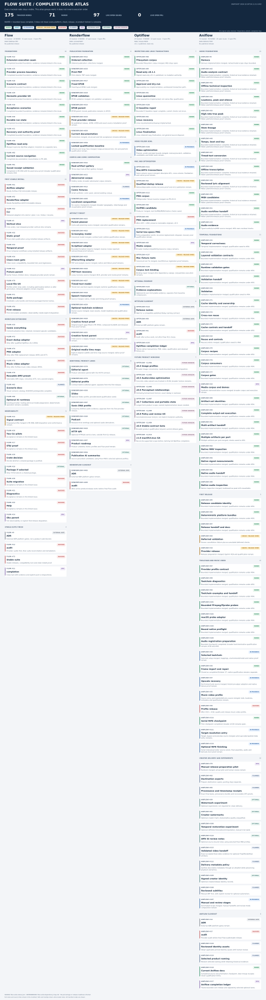
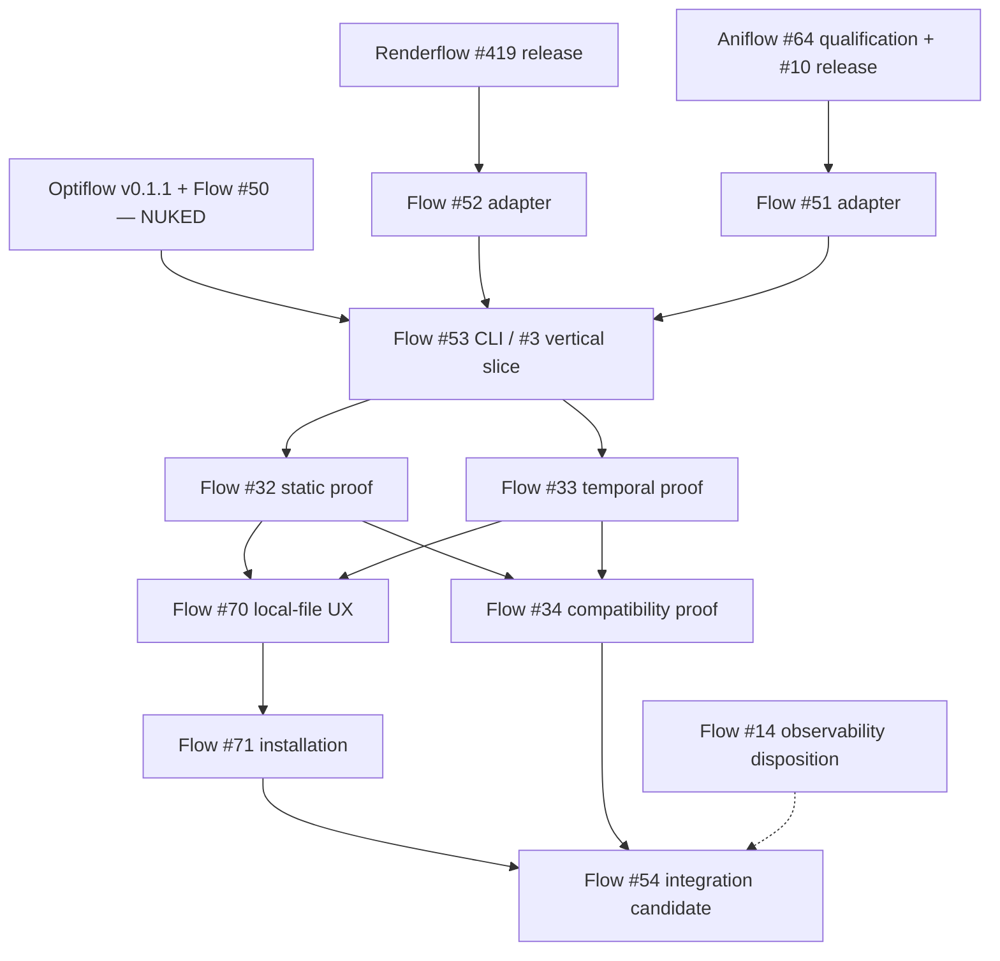
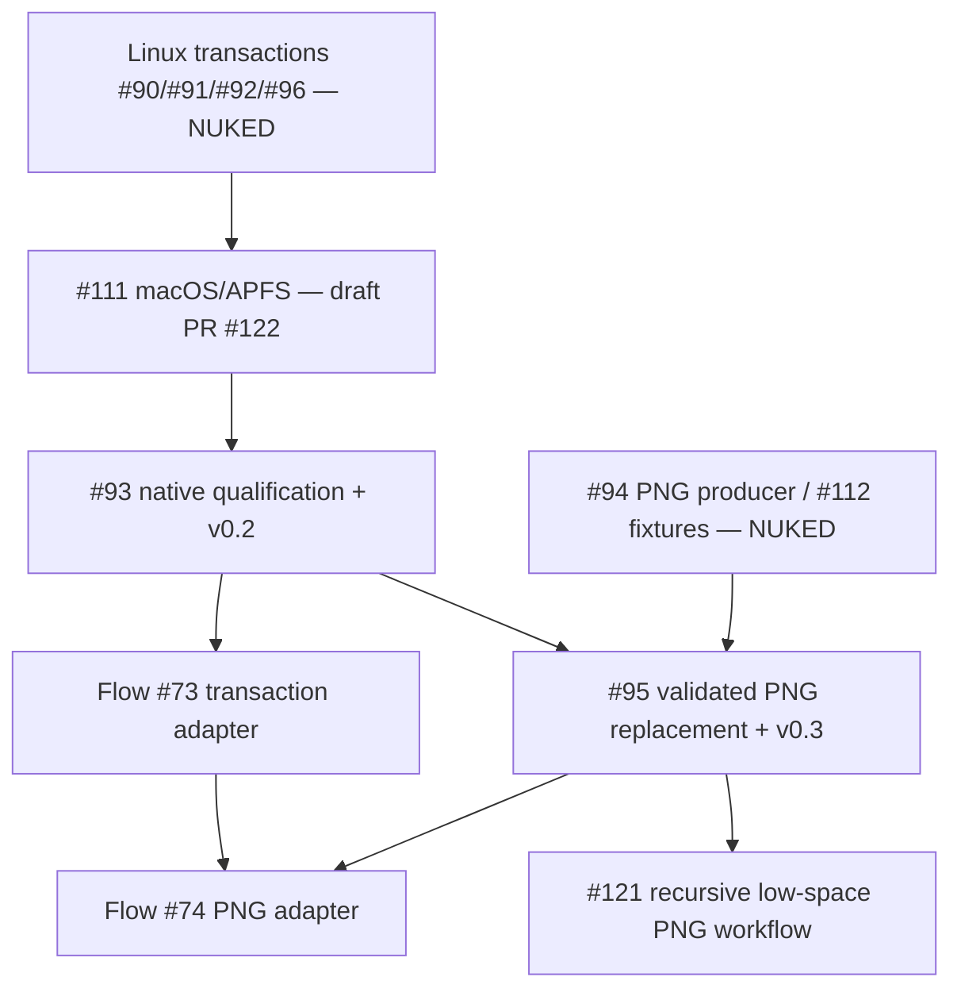
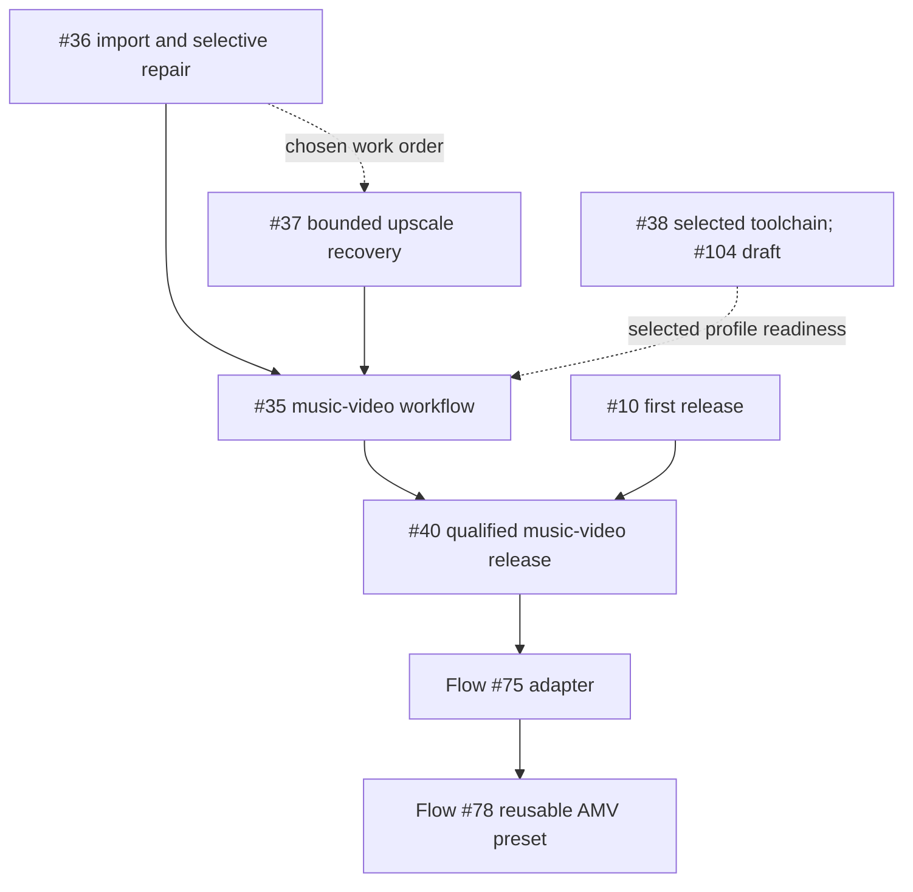
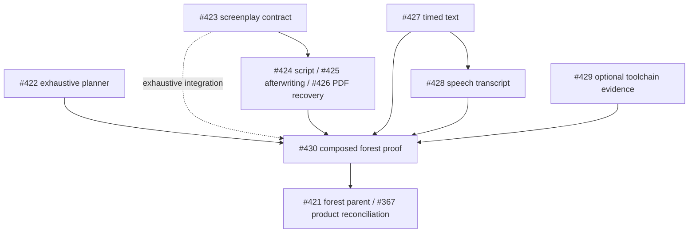
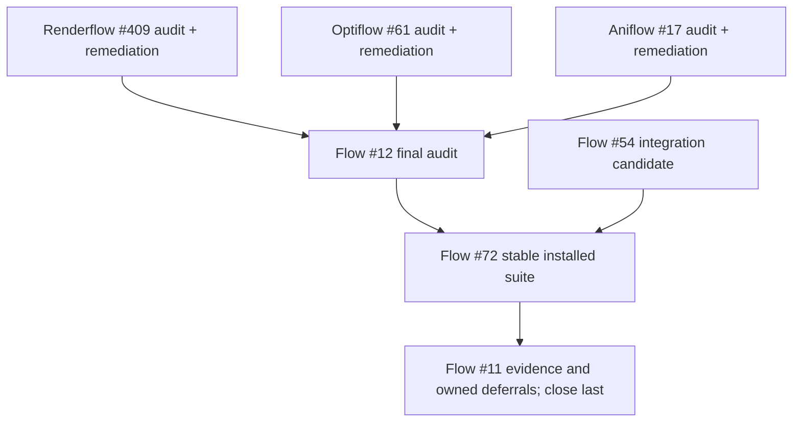

# Flow suite roadmap to completion

> **Current continuation: October 22, 2026.** Start with the
> [current handoff](../work/11/HANDOFF.md) and [live #11 ledger](https://github.com/egohygiene/flow/issues/11).
> The durable kernel, read-only Optiflow adapter and #81 repair are merged.
> After #82, #15 is next. The source/release matrix and qualification limits
> are in the handoff. The October 6 atlas and October 15 provider note below
> retain their original observation boundaries, counts and nodes. Their old
> Aniflow draft states are historical; PRs #105/#115 have since merged while
> qualification/release remains open. No graph or census was regenerated.

## Preserved roadmap observations — October 6 and October 15, 2026

> **Latest provider execution-order refresh: October 15, 2026.** Read the
> [bounded three-provider execution order](flow-suite-execution-order-2026-10-15.md)
> for current Renderflow, Aniflow and Optiflow pins, existing drafts, remaining
> qualification and release gates. The full graph, JSON and counts below retain
> their **October 6** observation boundary; they were not regenerated or promoted
> to a fresh complete Flow inventory by that refresh.

**Snapshot: October 6, 2026.** The suite has substantial merged foundations,
but a complete installable Flow suite is still ahead. Optiflow has a published
**read-only v0.1.1**; Flow, Renderflow and Aniflow have no published GitHub
release in this snapshot. Merged code, platform qualification and shipped
products are separate milestones.

This maintained roadmap belongs to [Flow #11](https://github.com/egohygiene/flow/issues/11).
[Root ROADMAP](../../ROADMAP.md) owns strategic horizons; linked issues own
acceptance. This documentation does not authorize execution, merge, media
mutation, model spending or publication.

## Open the new diagram

- **[Full zoomable diagram: all 150 nodes](flow-suite-completion.svg)** — every
  original node, every open issue, newer completed checkpoints, and product horizons.
- [Editable full Mermaid dependency source](flow-suite-completion.mmd) — all
  205 relationships, with required dependencies separated from scoped links.
- [Machine-readable status snapshot](flow-suite-status.json) — exact observed
  heads, issue state, source links, notes, PRs and relationships.
- [Original September 27 Mermaid](archive/flow-suite-dependencies-2026-09-27.mmd)
  — preserved unchanged. Earlier maintained versions remain in Git history.



The rendered diagram groups work into four repository columns. It is an issue
atlas, not an implied linear schedule; dependency arrows live in the Mermaid
source, focused views and complete relationship table below. PNG export is
available through the generator; SVG is the committed scalable visual.

## What is included

- **All 80 original nodes retained.** The uploaded image was recovered and
  viewed; its nine lanes match the archived public Mermaid source from
  [the original Flow #11 comment](https://github.com/egohygiene/flow/issues/11#issuecomment-5856716651).
- **All 78 currently open issues** across the four repositories, excluding PRs.
- **Every issue created on or after September 27** in the inspected live issue
  collections, including completed checkpoint children, plus earlier completed
  foundations needed to explain current progress. Each collection reaches back
  before that cutoff. This is not a claim to include every historical issue.
- **143 issue nodes: 65 NUKED and 78 open**, plus **seven future Optiflow product
  horizons** that still need bounded issue decomposition. Parents and children
  have different sizes; these counts are not a completion percentage.
- **Two existing draft PRs**: Optiflow #122 and Aniflow #105. This documentation
  PR is subsequent to the product snapshot and is not in that count.

**NUKED** means the bounded GitHub issue is closed as completed. It does not
erase deferred validation or imply that its parent, platform or release is done.
**DRAFT** means implementation is under review. **QUALIFICATION / RELEASE**
means checks or shipping gates remain. **BLOCKED** means declared prerequisites
remain; parts may still be prepared. **PARENT OPEN** retains broader acceptance.
**OPTIONAL** is a product lane outside the first baseline release, not a silent
decision to abandon it. **FUTURE HORIZON** is strategic scope without a new
invented issue number.

## Where each project stands

| Project | What is already NUKED | What closes the current gap |
| --- | --- | --- |
| Flow | Provider execution boundary, scenarios, durable state, recovery and read-only Optiflow adapter | Released Aniflow/Renderflow adapters, public CLI, installed-provider proofs, local-file UX, distribution and release |
| Renderflow | Ordered collections, print PDF, fixed-layout EPUB, EPUB validation and initial real-artifact gallery | Publish #419; finish the forest/comic/corpus lanes and selected product profiles; audit and remediate |
| Optiflow | Read-only v0.1.1, bounded Linux transactions, PNG fixtures and candidate producer | Finish #111, qualify/publish #93, safe PNG replacement #95, low-space workflow #121; broader pre-v1 horizons remain |
| Aniflow | Audio, temporal execution, validation/reuse, multi-artifact/native audio and most toolchain foundations | Finish #104/#38, repair deferred checks #64, publish #10, compose/qualify the music-video and creator-delivery lanes |

Optiflow #94/#112 reached main through [PR #113](https://github.com/egohygiene/optiflow/pull/113),
including its stacked PR #114. Aniflow #75–#77, #85–#87 and #97–#103 are also
merged, through PRs #78, #88 and #100 respectively. Older issue-body handoffs or
repository roadmap text may still call those PRs draft; current PR/issue state
takes precedence. Those merges did not perform the deferred checks.

## Three finish lines

1. **First usable installed suite:** immutable provider releases and adapters,
   a supported CLI, real static/temporal workflows, local-file UX, verified
   installation and Flow's first integration candidate (#54). Optiflow mutation
   and AMV extras are advertised only when their separate release/proof gates pass.
2. **Stable supported suite:** selected capability matrix, provider audits,
   Flow audit/remediation and clean-install proof, ending in #72 and then #11.
   Every remaining issue must be completed or have an explicit owned deferral.
3. **Full product backlog:** all retained feature lanes and accepted product
   horizons, including Optiflow v0.4 through v1.0. The current PNG/low-space chain
   does not by itself finish the entire Optiflow vision. Optional experiments
   require an explicit keep/defer/decline decision, not forced inclusion in v1.

## Route to the first usable suite



Flow #53 declares all three adapters as dependencies, while its acceptance
allows Optiflow + Renderflow proof first and the Aniflow route when released.
That permits staged implementation; final acceptance still needs an explicit
resolution of the declared #51 dependency. Durable #31/#49 prerequisites are
already NUKED. Flow #54 also retains its direct #3/#34/#70/#71 gates.

## Optiflow route and the low-space goal



#111 has four authored, unvalidated checkpoints in draft PR #122. The safe ACL
proposal is inert and unadopted; Mac cross-volume mutation and finalization
remain unavailable. #93 still needs native disposable-volume pilots, recovery
and physical-disconnect evidence, supported-target installation, signing and
publication. #94's merged producer still owes real OxiPNG, MSRV and native Mac
qualification. #95 preserves restorable originals. #121 separately allows
explicit original disposal for its qualified PNG subset, processing one file
at a time with candidate/scratch space; it does not promise zero extra bytes.
#65 stays open for broader corpus coverage, with exact required fixture subsets
used by consumers instead of making the entire corpus a blanket prerequisite.

## Aniflow and the anime music-video preset



#36 can start from merged #32/#33. #37 follows as a useful work order, not an
invented prerequisite on #36. #38's remaining registration and broader tool/
model/mapping proof stays open despite merged doctor and preflight foundations.
The preset declares selected steps and consumes released provider contracts;
it is not a second execution engine. #80 native source inspection is NUKED;
#83 destination candidates and #82 provenance/OpenTimestamps remain open.
For delivery, transform/export the chosen artifacts before hashing their final
bytes. #39 cleanup, #81 creator marks and #106 restoration/interpolation remain
optional; none is required for clean delivery. #79's manual runbook is merged,
but the actual pilot and human review are still owed. No posting is implied.

## Renderflow's remaining product work



#422 planner, #423 schema design and #427 timed-text work can start independently.
#429 consolidates evidence; it does not block adapter authoring. #433's gallery
is NUKED, while #412's larger corpus remains. #413's initial static comic pack
can use merged PDF/EPUB work now; later #406 layered/localization coverage is a
separate expansion. #378/#379 coordinate their editorial contract without a
Copilot runtime prerequisite. Slides #350, audio variants #397, briefings #349
and HTTP #420 remain visible product lanes, with their actual release and
provider qualification requirements preserved.

## Observability, audits and stable closeout

Flow #15 contract/privacy design can proceed independently; #16–#18 develop
receipts, trace export and the package decision. #19 exists only if #18 selects
a shared package; #20–#22 complete integration, recovery and proof, then #14
reconciles acceptance. The first candidate needs an explicit #14 disposition.
Flow #62 is documentation work whose #28/#30 prerequisites are already done.



Provider audits wait for their active implementation/release sequence, not for
Flow #11 to close. That avoids a circular finish gate. The external ADR issues
Flow #9, Renderflow #405, Optiflow #60 and Aniflow #14 remain tracked governance
work; they are not new blockers on ordinary product coding. Flow #10's comic
artifact tree also retains its newer upscale-candidate/retention addendum:
preserve original baselines, explicit model branches, external artifact-store
lineage and exact reviewed bytes.

## Complete issue and horizon inventory

“Original” marks nodes in the September 27 diagram; “Added” includes both newer
issues and earlier completed foundations added for context. Every node has one
entry here. Full issue titles and acceptance remain at the linked source.


### Flow

38 nodes; 8 NUKED; 30 open issues.

| Issue / horizon | Group | Status | Origin | Remaining scope / evidence |
| --- | --- | --- | --- | --- |
| [flow #23](https://github.com/egohygiene/flow/issues/23) — Extension execution seam | Foundations | **NUKED** | Added | Completed bounded foundation; evidence remains linked in the issue. |
| [flow #25](https://github.com/egohygiene/flow/issues/25) — Provider process boundary | Foundations | **NUKED** | Added | Completed bounded foundation; evidence remains linked in the issue. |
| [flow #28](https://github.com/egohygiene/flow/issues/28) — Scenario contract | Foundations | **NUKED** | Added | Completed bounded foundation; evidence remains linked in the issue. |
| [flow #29](https://github.com/egohygiene/flow/issues/29) — Hermetic provider kit | Foundations | **NUKED** | Added | Completed bounded foundation; evidence remains linked in the issue. |
| [flow #30](https://github.com/egohygiene/flow/issues/30) — Acceptance scenarios | Foundations | **NUKED** | Added | Completed bounded foundation; evidence remains linked in the issue. |
| [flow #49](https://github.com/egohygiene/flow/issues/49) — Durable run state | Foundations | **NUKED** | Added | Completed bounded foundation; evidence remains linked in the issue. |
| [flow #31](https://github.com/egohygiene/flow/issues/31) — Recovery and authority proof | Foundations | **NUKED** | Added | Completed bounded foundation; evidence remains linked in the issue. |
| [flow #50](https://github.com/egohygiene/flow/issues/50) — Optiflow read-only | Foundations | **NUKED** | Original | Merged read-only Optiflow adapter; mutation is a separate lane. |
| [flow #51](https://github.com/egohygiene/flow/issues/51) — Aniflow adapter | First usable install | **BLOCKED** | Original | Needs Aniflow #10 immutable release. |
| [flow #52](https://github.com/egohygiene/flow/issues/52) — Renderflow adapter | First usable install | **BLOCKED** | Original | Needs Renderflow #419 immutable release. |
| [flow #53](https://github.com/egohygiene/flow/issues/53) — CLI | First usable install | **BLOCKED** | Original | Released adapters into doctor / plan / run / status / resume. |
| [flow #3](https://github.com/egohygiene/flow/issues/3) — Vertical slice | First usable install | **PARENT OPEN** | Original | Core exists; real released-provider vertical slice remains. |
| [flow #32](https://github.com/egohygiene/flow/issues/32) — Static proof | First usable install | **BLOCKED** | Original | Prove static publication using installed release artifacts. |
| [flow #33](https://github.com/egohygiene/flow/issues/33) — Temporal proof | First usable install | **BLOCKED** | Original | Prove temporal workflows using installed release artifacts. |
| [flow #34](https://github.com/egohygiene/flow/issues/34) — Clean-room gate | First usable install | **BLOCKED** | Original | Clean-room compatibility, bounded tiers and regressions. |
| [flow #13](https://github.com/egohygiene/flow/issues/13) — Fixture parent | First usable install | **PARENT OPEN** | Original | Earlier fixture children done; released-provider proofs remain. |
| [flow #70](https://github.com/egohygiene/flow/issues/70) — Local-file UX | First usable install | **BLOCKED** | Original | Simple local-file workflows after CLI and static/temporal proof. |
| [flow #71](https://github.com/egohygiene/flow/issues/71) — Suite package | First usable install | **BLOCKED** | Original | Installable suite bundle and honest package/channel names. |
| [flow #54](https://github.com/egohygiene/flow/issues/54) — First release | First usable install | **BLOCKED** | Original | First immutable candidate; observability needs explicit disposition. |
| [flow #10](https://github.com/egohygiene/flow/issues/10) — Comic everything | Workflow extensions | **BLOCKED** | Original | Comic/localization tree; retained, reviewed upscale candidates. |
| [flow #73](https://github.com/egohygiene/flow/issues/73) — Exact dedup adapter | Workflow extensions | **BLOCKED** | Original | Only after qualified Optiflow v0.2 (#93). |
| [flow #74](https://github.com/egohygiene/flow/issues/74) — PNG adapter | Workflow extensions | **BLOCKED** | Original | Only after PNG replacement release (#95) and #73. |
| [flow #75](https://github.com/egohygiene/flow/issues/75) — Music-video adapter | Workflow extensions | **BLOCKED** | Original | Only after Aniflow music-video release (#40). |
| [flow #78](https://github.com/egohygiene/flow/issues/78) — Reusable AMV preset | Workflow extensions | **BLOCKED** | Added | Selectable AMV steps; consumes #75, not a second engine. |
| [flow #62](https://github.com/egohygiene/flow/issues/62) — Scenario docs | Workflow extensions | **PLANNED** | Original | Visual scenario catalog; #28/#30 prerequisites complete. |
| [flow #15](https://github.com/egohygiene/flow/issues/15) — Signal contract | Observability | **PLANNED** | Original | Contract and privacy design; no instrumentation yet. |
| [flow #16](https://github.com/egohygiene/flow/issues/16) — Two CLI pilots | Observability | **BLOCKED** | Original | Acceptance remains in the linked issue. |
| [flow #17](https://github.com/egohygiene/flow/issues/17) — OTel proof | Observability | **BLOCKED** | Original | Acceptance remains in the linked issue. |
| [flow #18](https://github.com/egohygiene/flow/issues/18) — Crate decision | Observability | **BLOCKED** | Original | Decide whether a shared package is justified. |
| [flow #19](https://github.com/egohygiene/flow/issues/19) — Package if selected | Observability | **OPTIONAL** | Original | Only if #18 selects a shared package. |
| [flow #20](https://github.com/egohygiene/flow/issues/20) — Suite migration | Observability | **BLOCKED** | Original | Acceptance remains in the linked issue. |
| [flow #21](https://github.com/egohygiene/flow/issues/21) — Diagnostics | Observability | **BLOCKED** | Original | Acceptance remains in the linked issue. |
| [flow #22](https://github.com/egohygiene/flow/issues/22) — Help | Observability | **BLOCKED** | Original | Acceptance remains in the linked issue. |
| [flow #14](https://github.com/egohygiene/flow/issues/14) — Obs parent | Observability | **PARENT OPEN** | Original | Full observability or explicit first-release disposition. |
| [flow #9](https://github.com/egohygiene/flow/issues/9) — ADR | Stable-suite finish | **EXTERNAL GATE** | Original | External ADR platform gates; not a product-code blocker. |
| [flow #12](https://github.com/egohygiene/flow/issues/12) — audit | Stable-suite finish | **BLOCKED** | Original | Provider audits first, then suite reconciliation and remediation. |
| [flow #72](https://github.com/egohygiene/flow/issues/72) — Stable suite | Stable-suite finish | **BLOCKED** | Original | Stable releases, compatibility lock and clean-install proof. |
| [flow #11](https://github.com/egohygiene/flow/issues/11) — completion | Stable-suite finish | **PARENT OPEN** | Original | Close last with evidence and explicit post-v1 dispositions. |

### Renderflow

29 nodes; 6 NUKED; 23 open issues.

| Issue / horizon | Group | Status | Origin | Remaining scope / evidence |
| --- | --- | --- | --- | --- |
| [renderflow #415](https://github.com/egohygiene/renderflow/issues/415) — Ordered collection | Publication foundation | **NUKED** | Original | Ordered publication collections merged. |
| [renderflow #416](https://github.com/egohygiene/renderflow/issues/416) — Print PDF | Publication foundation | **NUKED** | Original | Print-interior PDF route merged. |
| [renderflow #417](https://github.com/egohygiene/renderflow/issues/417) — Fixed EPUB | Publication foundation | **NUKED** | Original | Fixed-layout EPUB route merged. |
| [renderflow #418](https://github.com/egohygiene/renderflow/issues/418) — EPUB validation | Publication foundation | **NUKED** | Original | EPUB validation merged; not publisher acceptance. |
| [renderflow #414](https://github.com/egohygiene/renderflow/issues/414) — EPUB parent | Publication foundation | **NUKED** | Original | EPUB parent closed; publication remains in #419. |
| [renderflow #419](https://github.com/egohygiene/renderflow/issues/419) — Provider release | Publication foundation | **QUALIFICATION / RELEASE** | Original | Release preparation merged; no GitHub release published. |
| [renderflow #433](https://github.com/egohygiene/renderflow/issues/433) — Real-artifact gallery | Corpus and comic composition | **NUKED** | Added | Three-input real-artifact gallery merged. |
| [renderflow #412](https://github.com/egohygiene/renderflow/issues/412) — Adversarial corpus | Corpus and comic composition | **PARENT OPEN** | Original | Gallery exists; broader adversarial corpus remains. |
| [renderflow #413](https://github.com/egohygiene/renderflow/issues/413) — Comic fixtures | Corpus and comic composition | **PLANNED** | Original | Small synthetic comic pack; extend existing corpus. |
| [renderflow #406](https://github.com/egohygiene/renderflow/issues/406) — Localization | Corpus and comic composition | **PLANNED** | Original | Layered composition and locale branches; preserve originals. |
| [renderflow #422](https://github.com/egohygiene/renderflow/issues/422) — Forest planner | Artifact forest | **PLANNED** | Original | Cycle-safe, deduplicated targets; no new provider required. |
| [renderflow #423](https://github.com/egohygiene/renderflow/issues/423) — Screenplay model | Artifact forest | **PLANNED** | Original | Schema/design can start independently of #422. |
| [renderflow #424](https://github.com/egohygiene/renderflow/issues/424) — Scripttool adapter | Artifact forest | **BLOCKED** | Original | Needs #423 screenplay model. |
| [renderflow #425](https://github.com/egohygiene/renderflow/issues/425) — Fountain PDF | Artifact forest | **BLOCKED** | Original | Needs #423 screenplay model. |
| [renderflow #426](https://github.com/egohygiene/renderflow/issues/426) — PDF recovery | Artifact forest | **BLOCKED** | Original | Needs #423; recovery must record information loss. |
| [renderflow #427](https://github.com/egohygiene/renderflow/issues/427) — Timed text | Artifact forest | **PLANNED** | Original | Independent timed-text and embedded subtitle extraction. |
| [renderflow #428](https://github.com/egohygiene/renderflow/issues/428) — Speech transcript | Artifact forest | **BLOCKED** | Original | Needs #427 transcript contract. |
| [renderflow #429](https://github.com/egohygiene/renderflow/issues/429) — Creative doctor | Artifact forest | **PLANNED** | Original | Consolidates optional tools; does not block adapter work. |
| [renderflow #430](https://github.com/egohygiene/renderflow/issues/430) — Forest proof | Artifact forest | **BLOCKED** | Original | Integrate #422–#429 and hand off truthful artifacts to Flow. |
| [renderflow #421](https://github.com/egohygiene/renderflow/issues/421) — Forest parent | Artifact forest | **PARENT OPEN** | Original | Forest parent closes after child acceptance. |
| [renderflow #378](https://github.com/egohygiene/renderflow/issues/378) — Article copilot | Additional product lanes | **PLANNED** | Original | Editorial agent; coordinate metadata with #379. |
| [renderflow #379](https://github.com/egohygiene/renderflow/issues/379) — Editorial profile | Additional product lanes | **PLANNED** | Original | Editorial rendering; no Copilot runtime dependency. |
| [renderflow #350](https://github.com/egohygiene/renderflow/issues/350) — Slides | Additional product lanes | **OPTIONAL** | Original | Optional Slidev profile; provider/asset qualification owed. |
| [renderflow #397](https://github.com/egohygiene/renderflow/issues/397) — Sonic DNA | Additional product lanes | **PLANNED** | Original | Audio evidence prerequisites implemented; integration remains. |
| [renderflow #349](https://github.com/egohygiene/renderflow/issues/349) — Podcast | Additional product lanes | **OPTIONAL** | Original | Research-first briefings and optional audio derivatives. |
| [renderflow #420](https://github.com/egohygiene/renderflow/issues/420) — HTTP API | Additional product lanes | **OPTIONAL** | Original | Optional HTTP/job-service lane, outside first CLI release. |
| [renderflow #367](https://github.com/egohygiene/renderflow/issues/367) — Product roadmap | Additional product lanes | **PARENT OPEN** | Original | Product umbrella; forest, profiles and Flow proof remain. |
| [renderflow #405](https://github.com/egohygiene/renderflow/issues/405) — ADR | Renderflow closeout | **EXTERNAL GATE** | Original | External ADR platform gates remain. |
| [renderflow #409](https://github.com/egohygiene/renderflow/issues/409) — audit | Renderflow closeout | **BLOCKED** | Original | After active product/release work; before final Flow audit. |

### Optiflow

24 nodes; 9 NUKED; 8 open issues.

| Issue / horizon | Group | Status | Origin | Remaining scope / evidence |
| --- | --- | --- | --- | --- |
| [optiflow #88](https://github.com/egohygiene/optiflow/issues/88) — Filesystem corpus | Inspection and Linux transactions | **NUKED** | Added | Bounded filesystem corpus merged; #65 stays open. |
| [optiflow #89](https://github.com/egohygiene/optiflow/issues/89) — Read-only v0.1.1 | Inspection and Linux transactions | **NUKED** | Added | Signed read-only v0.1.1 published; no mutation authority. |
| [optiflow #90](https://github.com/egohygiene/optiflow/issues/90) — Approval and dry-run | Inspection and Linux transactions | **NUKED** | Added | Approval/dry-run implementation; unreleased transaction path. |
| [optiflow #91](https://github.com/egohygiene/optiflow/issues/91) — Linux quarantine | Inspection and Linux transactions | **NUKED** | Added | Linux quarantine implemented; not native Mac qualification. |
| [optiflow #106](https://github.com/egohygiene/optiflow/issues/106) — CI baseline repair | Inspection and Linux transactions | **NUKED** | Added | Bounded CI baseline repair complete; current checks not rerun. |
| [optiflow #92](https://github.com/egohygiene/optiflow/issues/92) — Linux recovery | Inspection and Linux transactions | **NUKED** | Added | Linux resume/restore/cleanup implemented. |
| [optiflow #96](https://github.com/egohygiene/optiflow/issues/96) — Linux finalization | Inspection and Linux transactions | **NUKED** | Added | Linux retained-copy finalization; not general source disposal. |
| [optiflow #111](https://github.com/egohygiene/optiflow/issues/111) — macOS APFS | Mac and optimization | **DRAFT** | Original | PR #122 draft; checks deferred. Mac cross-volume mutation/finalization unavailable; ACL proposal unadopted. |
| [optiflow #93](https://github.com/egohygiene/optiflow/issues/93) — v0.2 qualification | Mac and optimization | **BLOCKED** | Original | After #111: native pilots, recovery, signing and v0.2 release. |
| [optiflow #112](https://github.com/egohygiene/optiflow/issues/112) — PNG corpus | Mac and optimization | **NUKED** | Added | PNG/provider fixture tranche merged via PR #113. |
| [optiflow #94](https://github.com/egohygiene/optiflow/issues/94) — OxiPNG candidate | Mac and optimization | **NUKED** | Original | Producer merged; real OxiPNG/MSRV/native checks owed. |
| [optiflow #95](https://github.com/egohygiene/optiflow/issues/95) — PNG replacement | Mac and optimization | **BLOCKED** | Original | After #93 + #94; preserve restorable originals; v0.3. |
| [optiflow #121](https://github.com/egohygiene/optiflow/issues/121) — Recursive low-space workflow | Mac and optimization | **BLOCKED** | Added | After #95; qualified PNG subset, one candidate + scratch, explicit original disposal. |
| [optiflow #65](https://github.com/egohygiene/optiflow/issues/65) — Media corpus | Mac and optimization | **PARENT OPEN** | Original | Broader media/compatibility/resource corpus remains. |
| [optiflow #115](https://github.com/egohygiene/optiflow/issues/115) — Release names | Optiflow closeout | **EXTERNAL GATE** | Added | Wait for a compatible published Relay naming contract. |
| [optiflow #60](https://github.com/egohygiene/optiflow/issues/60) — ADR | Optiflow closeout | **EXTERNAL GATE** | Original | External ADR platform gates remain. |
| [optiflow #61](https://github.com/egohygiene/optiflow/issues/61) — audit | Optiflow closeout | **BLOCKED** | Original | Audit after active work; not after Flow #11 closes. |
| [v0.4 Image profiles](https://github.com/egohygiene/optiflow/blob/c5dbcd1761e810aea228389b8ba017acc97a411e/ROADMAP.md) — strategic horizon | Future product horizons | **FUTURE HORIZON** | Added | Broader image conversions; needs bounded issue decomposition. |
| [v0.5 Audio/video optimization](https://github.com/egohygiene/optiflow/blob/c5dbcd1761e810aea228389b8ba017acc97a411e/ROADMAP.md) — strategic horizon | Future product horizons | **FUTURE HORIZON** | Added | Product horizon; not delivered by the PNG transaction path. |
| [v0.6 Perceptual relationships](https://github.com/egohygiene/optiflow/blob/c5dbcd1761e810aea228389b8ba017acc97a411e/ROADMAP.md) — strategic horizon | Future product horizons | **FUTURE HORIZON** | Added | Similarity/containment horizon; exact dedup is narrower. |
| [v0.7 Collections and portable state](https://github.com/egohygiene/optiflow/blob/c5dbcd1761e810aea228389b8ba017acc97a411e/ROADMAP.md) — strategic horizon | Future product horizons | **FUTURE HORIZON** | Added | Longer-term product scope; named implementation issues needed. |
| [v0.8 Policy and review UX](https://github.com/egohygiene/optiflow/blob/c5dbcd1761e810aea228389b8ba017acc97a411e/ROADMAP.md) — strategic horizon | Future product horizons | **FUTURE HORIZON** | Added | Automation/review horizon; not implicit mutation authority. |
| [v0.9 Stable-contract beta](https://github.com/egohygiene/optiflow/blob/c5dbcd1761e810aea228389b8ba017acc97a411e/ROADMAP.md) — strategic horizon | Future product horizons | **FUTURE HORIZON** | Added | Broader product qualification beyond current release gates. |
| [v1.0 macOS/Linux GA](https://github.com/egohygiene/optiflow/blob/c5dbcd1761e810aea228389b8ba017acc97a411e/ROADMAP.md) — strategic horizon | Future product horizons | **FUTURE HORIZON** | Added | Reconcile supported scope before claiming full Optiflow completion. |

### Aniflow

59 nodes; 42 NUKED; 17 open issues.

| Issue / horizon | Group | Status | Origin | Remaining scope / evidence |
| --- | --- | --- | --- | --- |
| [aniflow #8](https://github.com/egohygiene/aniflow/issues/8) — Demucs | Audio foundations | **NUKED** | Original | Demucs implementation merged; native/model scope stays bounded. |
| [aniflow #42](https://github.com/egohygiene/aniflow/issues/42) — Audio analysis contract | Audio foundations | **NUKED** | Added | Bounded implementation complete; historical local evidence retained. Wider platform/release proof remains. |
| [aniflow #43](https://github.com/egohygiene/aniflow/issues/43) — Offline technical inspection | Audio foundations | **NUKED** | Added | Bounded implementation complete; historical local evidence retained. Wider platform/release proof remains. |
| [aniflow #44](https://github.com/egohygiene/aniflow/issues/44) — Loudness, peak and silence | Audio foundations | **NUKED** | Added | Bounded implementation complete; historical local evidence retained. Wider platform/release proof remains. |
| [aniflow #55](https://github.com/egohygiene/aniflow/issues/55) — High-rate true peak | Audio foundations | **NUKED** | Added | Bounded implementation complete; historical local evidence retained. Wider platform/release proof remains. |
| [aniflow #45](https://github.com/egohygiene/aniflow/issues/45) — Stem lineage | Audio foundations | **NUKED** | Added | Bounded implementation complete; historical local evidence retained. Wider platform/release proof remains. |
| [aniflow #46](https://github.com/egohygiene/aniflow/issues/46) — Tempo, beat and key | Audio foundations | **NUKED** | Added | Bounded implementation complete; historical local evidence retained. Wider platform/release proof remains. |
| [aniflow #47](https://github.com/egohygiene/aniflow/issues/47) — Timed-text conversion | Audio foundations | **NUKED** | Added | Bounded implementation complete; historical local evidence retained. Wider platform/release proof remains. |
| [aniflow #48](https://github.com/egohygiene/aniflow/issues/48) — Offline transcription | Audio foundations | **NUKED** | Added | Bounded implementation complete; historical local evidence retained. Wider platform/release proof remains. |
| [aniflow #49](https://github.com/egohygiene/aniflow/issues/49) — Reviewed lyric alignment | Audio foundations | **NUKED** | Added | Bounded implementation complete; historical local evidence retained. Wider platform/release proof remains. |
| [aniflow #50](https://github.com/egohygiene/aniflow/issues/50) — MIDI candidates | Audio foundations | **NUKED** | Added | Bounded implementation complete; historical local evidence retained. Wider platform/release proof remains. |
| [aniflow #51](https://github.com/egohygiene/aniflow/issues/51) — Audio workflow handoff | Audio foundations | **NUKED** | Added | Bounded implementation complete; historical local evidence retained. Wider platform/release proof remains. |
| [aniflow #13](https://github.com/egohygiene/aniflow/issues/13) — Audio evidence | Audio foundations | **NUKED** | Original | Typed audio/lyrics/MIDI source merged; #64 owns residual checks. |
| [aniflow #32](https://github.com/egohygiene/aniflow/issues/32) — Temporal correctness | Temporal foundations | **NUKED** | Original | Temporal implementation merged; qualification owed to #64. |
| [aniflow #66](https://github.com/egohygiene/aniflow/issues/66) — Layered validation contracts | Temporal foundations | **NUKED** | Added | Bounded implementation merged; qualification remains under #64. |
| [aniflow #67](https://github.com/egohygiene/aniflow/issues/67) — Runtime validation gates | Temporal foundations | **NUKED** | Added | Bounded implementation merged; qualification remains under #64. |
| [aniflow #68](https://github.com/egohygiene/aniflow/issues/68) — Validation handoff | Temporal foundations | **NUKED** | Added | Bounded implementation merged; qualification remains under #64. |
| [aniflow #33](https://github.com/egohygiene/aniflow/issues/33) — Validation | Temporal foundations | **NUKED** | Original | Validation implementation merged; qualification owed to #64. |
| [aniflow #71](https://github.com/egohygiene/aniflow/issues/71) — Cache identity and ownership | Temporal foundations | **NUKED** | Added | Bounded implementation merged; qualification remains under #64. |
| [aniflow #72](https://github.com/egohygiene/aniflow/issues/72) — Cross-run reuse | Temporal foundations | **NUKED** | Added | Bounded implementation merged; qualification remains under #64. |
| [aniflow #73](https://github.com/egohygiene/aniflow/issues/73) — Cache controls and handoff | Temporal foundations | **NUKED** | Added | Bounded implementation merged; qualification remains under #64. |
| [aniflow #34](https://github.com/egohygiene/aniflow/issues/34) — Reuse and controls | Temporal foundations | **NUKED** | Original | Reuse/controls merged; qualification owed to #64. |
| [aniflow #75](https://github.com/egohygiene/aniflow/issues/75) — Corpus recipes | Temporal foundations | **NUKED** | Added | Bounded implementation merged; qualification remains under #64. |
| [aniflow #76](https://github.com/egohygiene/aniflow/issues/76) — Corpus consumers | Temporal foundations | **NUKED** | Added | Bounded implementation merged; qualification remains under #64. |
| [aniflow #77](https://github.com/egohygiene/aniflow/issues/77) — Corpus gates | Temporal foundations | **NUKED** | Added | Bounded implementation merged; qualification remains under #64. |
| [aniflow #24](https://github.com/egohygiene/aniflow/issues/24) — Media corpus | Temporal foundations | **PARENT OPEN** | Original | #75–#77 merged; broader corpus and qualification remain. |
| [aniflow #89](https://github.com/egohygiene/aniflow/issues/89) — Artifact-set identities | Temporal foundations | **NUKED** | Added | Bounded implementation merged; qualification remains under #64. |
| [aniflow #90](https://github.com/egohygiene/aniflow/issues/90) — Complete output-set execution | Temporal foundations | **NUKED** | Added | Bounded implementation merged; qualification remains under #64. |
| [aniflow #91](https://github.com/egohygiene/aniflow/issues/91) — Multi-artifact handoff | Temporal foundations | **NUKED** | Added | Bounded implementation merged; qualification remains under #64. |
| [aniflow #69](https://github.com/egohygiene/aniflow/issues/69) — Multiple artifacts per port | Temporal foundations | **NUKED** | Added | Multiple artifacts per port merged; checks owed to #64. |
| [aniflow #93](https://github.com/egohygiene/aniflow/issues/93) — Native WAV inspection | Temporal foundations | **NUKED** | Added | Bounded implementation merged; qualification remains under #64. |
| [aniflow #94](https://github.com/egohygiene/aniflow/issues/94) — Native signal measurements | Temporal foundations | **NUKED** | Added | Bounded implementation merged; qualification remains under #64. |
| [aniflow #95](https://github.com/egohygiene/aniflow/issues/95) — Native audio handoff | Temporal foundations | **NUKED** | Added | Bounded implementation merged; qualification remains under #64. |
| [aniflow #80](https://github.com/egohygiene/aniflow/issues/80) — Native audio inspection | Temporal foundations | **NUKED** | Added | Native inspection merged; loudness/true peak still unavailable. |
| [aniflow #85](https://github.com/egohygiene/aniflow/issues/85) — Release candidate identity | First release | **NUKED** | Added | Bounded implementation merged; qualification remains under #64. |
| [aniflow #86](https://github.com/egohygiene/aniflow/issues/86) — Deterministic platform bundles | First release | **NUKED** | Added | Bounded implementation merged; qualification remains under #64. |
| [aniflow #87](https://github.com/egohygiene/aniflow/issues/87) — Release handoff and docs | First release | **NUKED** | Added | Bounded implementation merged; qualification remains under #64. |
| [aniflow #64](https://github.com/egohygiene/aniflow/issues/64) — Deferred validation | First release | **QUALIFICATION / RELEASE** | Added | Known cancellation failure plus accumulated deferred checks. |
| [aniflow #10](https://github.com/egohygiene/aniflow/issues/10) — Provider release | First release | **QUALIFICATION / RELEASE** | Original | Release preparation merged; Egolint #29 and qualification remain. |
| [aniflow #97](https://github.com/egohygiene/aniflow/issues/97) — Provider profile contract | Toolchain and music video | **NUKED** | Added | Bounded implementation merged; qualification remains under #64. |
| [aniflow #98](https://github.com/egohygiene/aniflow/issues/98) — Toolchain diagnostics | Toolchain and music video | **NUKED** | Added | Bounded implementation merged; qualification remains under #64. |
| [aniflow #99](https://github.com/egohygiene/aniflow/issues/99) — Toolchain examples and handoff | Toolchain and music video | **NUKED** | Added | Bounded implementation merged; qualification remains under #64. |
| [aniflow #101](https://github.com/egohygiene/aniflow/issues/101) — Bounded FFmpeg/ffprobe probes | Toolchain and music video | **NUKED** | Added | Bounded implementation merged; qualification remains under #64. |
| [aniflow #102](https://github.com/egohygiene/aniflow/issues/102) — macOS probe adapter | Toolchain and music video | **NUKED** | Added | Bounded implementation merged; qualification remains under #64. |
| [aniflow #103](https://github.com/egohygiene/aniflow/issues/103) — Bound native preflight | Toolchain and music video | **NUKED** | Added | Bounded implementation merged; qualification remains under #64. |
| [aniflow #104](https://github.com/egohygiene/aniflow/issues/104) — Audio registration preparation | Toolchain and music video | **DRAFT** | Added | PR #105 draft; inert audio registration documents; unrun tests. |
| [aniflow #38](https://github.com/egohygiene/aniflow/issues/38) — Toolchain doctor | Toolchain and music video | **PARENT OPEN** | Original | Doctor/preflight merged; registration and broader tools remain. |
| [aniflow #36](https://github.com/egohygiene/aniflow/issues/36) — Frame import and repair | Toolchain and music video | **PLANNED** | Original | Immutable workspace import and explicit repair ranges. |
| [aniflow #37](https://github.com/egohygiene/aniflow/issues/37) — Upscale recovery | Toolchain and music video | **PLANNED** | Original | Bounded chunk/per-frame Upscayl recovery; native proof owed. |
| [aniflow #35](https://github.com/egohygiene/aniflow/issues/35) — Music-video profile | Toolchain and music video | **PARENT OPEN** | Original | Compose repair, upscale and validated delivery. |
| [aniflow #40](https://github.com/egohygiene/aniflow/issues/40) — Profile release | Toolchain and music video | **BLOCKED** | Original | After #35 + #10; qualify and release music-video profile. |
| [aniflow #79](https://github.com/egohygiene/aniflow/issues/79) — Manual release-preparation pilot | Creator delivery and experiments | **PARENT OPEN** | Added | Runbook merged; actual pilot and human review remain. |
| [aniflow #83](https://github.com/egohygiene/aniflow/issues/83) — Destination exports | Creator delivery and experiments | **PLANNED** | Added | Prepare destination copies; posting stays separate. |
| [aniflow #82](https://github.com/egohygiene/aniflow/issues/82) — Provenance and timestamp receipts | Creator delivery and experiments | **PLANNED** | Added | Exact final bytes, provenance bundle and recoverable OTS proofs. |
| [aniflow #39](https://github.com/egohygiene/aniflow/issues/39) — Watermark experiment | Creator delivery and experiments | **OPTIONAL** | Original | Optional experiment; not required for clean delivery. |
| [aniflow #81](https://github.com/egohygiene/aniflow/issues/81) — Creator watermarks | Creator delivery and experiments | **OPTIONAL** | Added | Optional creator mark; stereo/native quality unqualified. |
| [aniflow #106](https://github.com/egohygiene/aniflow/issues/106) — Temporal restoration experiment | Creator delivery and experiments | **OPTIONAL** | Added | Optional deflicker/restoration/interpolation; manual trial owed. |
| [aniflow #14](https://github.com/egohygiene/aniflow/issues/14) — ADR | Aniflow closeout | **EXTERNAL GATE** | Original | External ADR platform gates remain. |
| [aniflow #17](https://github.com/egohygiene/aniflow/issues/17) — audit | Aniflow closeout | **BLOCKED** | Original | Provider audit before final Flow audit/stable release. |

## Complete relationship inventory

Solid Mermaid arrows are declared requirements for the bounded target or parent closeout. Scoped arrows apply only to the named subset, coordination or selected optional branch. Sequence arrows record work order, not a hard prerequisite. A parent does not become a blanket runtime dependency. External gates are listed separately below.

| From | To | Kind | Scope |
| --- | --- | --- | --- |
| [flow #50](https://github.com/egohygiene/flow/issues/50) | [flow #53](https://github.com/egohygiene/flow/issues/53) | required | Declared target prerequisite / closeout |
| [flow #50](https://github.com/egohygiene/flow/issues/50) | [flow #73](https://github.com/egohygiene/flow/issues/73) | required | Declared target prerequisite / closeout |
| [flow #51](https://github.com/egohygiene/flow/issues/51) | [flow #53](https://github.com/egohygiene/flow/issues/53) | required | Declared target prerequisite / closeout |
| [flow #51](https://github.com/egohygiene/flow/issues/51) | [flow #75](https://github.com/egohygiene/flow/issues/75) | required | Declared target prerequisite / closeout |
| [flow #52](https://github.com/egohygiene/flow/issues/52) | [flow #53](https://github.com/egohygiene/flow/issues/53) | required | Declared target prerequisite / closeout |
| [flow #53](https://github.com/egohygiene/flow/issues/53) | [flow #3](https://github.com/egohygiene/flow/issues/3) | required | Declared target prerequisite / closeout |
| [flow #53](https://github.com/egohygiene/flow/issues/53) | [flow #70](https://github.com/egohygiene/flow/issues/70) | required | Declared target prerequisite / closeout |
| [flow #3](https://github.com/egohygiene/flow/issues/3) | [flow #32](https://github.com/egohygiene/flow/issues/32) | required | Declared target prerequisite / closeout |
| [flow #3](https://github.com/egohygiene/flow/issues/3) | [flow #33](https://github.com/egohygiene/flow/issues/33) | required | Declared target prerequisite / closeout |
| [flow #3](https://github.com/egohygiene/flow/issues/3) | [flow #54](https://github.com/egohygiene/flow/issues/54) | required | Declared target prerequisite / closeout |
| [flow #32](https://github.com/egohygiene/flow/issues/32) | [flow #34](https://github.com/egohygiene/flow/issues/34) | required | Declared target prerequisite / closeout |
| [flow #32](https://github.com/egohygiene/flow/issues/32) | [flow #70](https://github.com/egohygiene/flow/issues/70) | required | Declared target prerequisite / closeout |
| [flow #32](https://github.com/egohygiene/flow/issues/32) | [flow #10](https://github.com/egohygiene/flow/issues/10) | required | Declared target prerequisite / closeout |
| [flow #33](https://github.com/egohygiene/flow/issues/33) | [flow #34](https://github.com/egohygiene/flow/issues/34) | required | Declared target prerequisite / closeout |
| [flow #33](https://github.com/egohygiene/flow/issues/33) | [flow #70](https://github.com/egohygiene/flow/issues/70) | required | Declared target prerequisite / closeout |
| [flow #34](https://github.com/egohygiene/flow/issues/34) | [flow #13](https://github.com/egohygiene/flow/issues/13) | required | Declared target prerequisite / closeout |
| [flow #34](https://github.com/egohygiene/flow/issues/34) | [flow #54](https://github.com/egohygiene/flow/issues/54) | required | Declared target prerequisite / closeout |
| [flow #13](https://github.com/egohygiene/flow/issues/13) | [flow #12](https://github.com/egohygiene/flow/issues/12) | required | Declared target prerequisite / closeout |
| [flow #70](https://github.com/egohygiene/flow/issues/70) | [flow #71](https://github.com/egohygiene/flow/issues/71) | required | Declared target prerequisite / closeout |
| [flow #71](https://github.com/egohygiene/flow/issues/71) | [flow #54](https://github.com/egohygiene/flow/issues/54) | required | Declared target prerequisite / closeout |
| [flow #54](https://github.com/egohygiene/flow/issues/54) | [flow #12](https://github.com/egohygiene/flow/issues/12) | required | Declared target prerequisite / closeout |
| [flow #54](https://github.com/egohygiene/flow/issues/54) | [flow #72](https://github.com/egohygiene/flow/issues/72) | required | Declared target prerequisite / closeout |
| [renderflow #415](https://github.com/egohygiene/renderflow/issues/415) | [renderflow #416](https://github.com/egohygiene/renderflow/issues/416) | required | Declared target prerequisite / closeout |
| [renderflow #415](https://github.com/egohygiene/renderflow/issues/415) | [renderflow #417](https://github.com/egohygiene/renderflow/issues/417) | required | Declared target prerequisite / closeout |
| [renderflow #416](https://github.com/egohygiene/renderflow/issues/416) | [renderflow #419](https://github.com/egohygiene/renderflow/issues/419) | required | Declared target prerequisite / closeout |
| [renderflow #416](https://github.com/egohygiene/renderflow/issues/416) | [renderflow #413](https://github.com/egohygiene/renderflow/issues/413) | required | Declared target prerequisite / closeout |
| [renderflow #417](https://github.com/egohygiene/renderflow/issues/417) | [renderflow #418](https://github.com/egohygiene/renderflow/issues/418) | required | Declared target prerequisite / closeout |
| [renderflow #418](https://github.com/egohygiene/renderflow/issues/418) | [renderflow #419](https://github.com/egohygiene/renderflow/issues/419) | required | Declared target prerequisite / closeout |
| [renderflow #418](https://github.com/egohygiene/renderflow/issues/418) | [renderflow #413](https://github.com/egohygiene/renderflow/issues/413) | required | Declared target prerequisite / closeout |
| [renderflow #418](https://github.com/egohygiene/renderflow/issues/418) | [renderflow #414](https://github.com/egohygiene/renderflow/issues/414) | scoped | parent close |
| [renderflow #419](https://github.com/egohygiene/renderflow/issues/419) | [flow #52](https://github.com/egohygiene/flow/issues/52) | required | Declared target prerequisite / closeout |
| [renderflow #419](https://github.com/egohygiene/renderflow/issues/419) | [renderflow #409](https://github.com/egohygiene/renderflow/issues/409) | required | Declared target prerequisite / closeout |
| [renderflow #412](https://github.com/egohygiene/renderflow/issues/412) | [flow #33](https://github.com/egohygiene/flow/issues/33) | scoped | fixture subset; [R413](https://github.com/egohygiene/renderflow/issues/413): corpus coordination |
| [renderflow #413](https://github.com/egohygiene/renderflow/issues/413) | [flow #32](https://github.com/egohygiene/flow/issues/32) | scoped | fixture subset |
| [aniflow #8](https://github.com/egohygiene/aniflow/issues/8) | [aniflow #13](https://github.com/egohygiene/aniflow/issues/13) | required | Declared target prerequisite / closeout |
| [aniflow #13](https://github.com/egohygiene/aniflow/issues/13) | [renderflow #397](https://github.com/egohygiene/renderflow/issues/397) | required | Declared target prerequisite / closeout |
| [aniflow #13](https://github.com/egohygiene/aniflow/issues/13) | [renderflow #349](https://github.com/egohygiene/renderflow/issues/349) | required | Declared target prerequisite / closeout |
| [aniflow #32](https://github.com/egohygiene/aniflow/issues/32) | [aniflow #33](https://github.com/egohygiene/aniflow/issues/33) | required | Declared target prerequisite / closeout |
| [aniflow #33](https://github.com/egohygiene/aniflow/issues/33) | [aniflow #34](https://github.com/egohygiene/aniflow/issues/34) | required | Declared target prerequisite / closeout |
| [aniflow #33](https://github.com/egohygiene/aniflow/issues/33) | [aniflow #36](https://github.com/egohygiene/aniflow/issues/36) | required | Declared target prerequisite / closeout |
| [aniflow #33](https://github.com/egohygiene/aniflow/issues/33) | [aniflow #69](https://github.com/egohygiene/aniflow/issues/69) | scoped | cardinality follow-up |
| [aniflow #34](https://github.com/egohygiene/aniflow/issues/34) | [aniflow #75](https://github.com/egohygiene/aniflow/issues/75) | required | Declared target prerequisite / closeout |
| [aniflow #24](https://github.com/egohygiene/aniflow/issues/24) | [flow #33](https://github.com/egohygiene/flow/issues/33) | scoped | fixture subset; [A10](https://github.com/egohygiene/aniflow/issues/10): bounded corpus qualification |
| [aniflow #10](https://github.com/egohygiene/aniflow/issues/10) | [flow #51](https://github.com/egohygiene/flow/issues/51) | required | Declared target prerequisite / closeout |
| [aniflow #10](https://github.com/egohygiene/aniflow/issues/10) | [aniflow #40](https://github.com/egohygiene/aniflow/issues/40) | required | Declared target prerequisite / closeout |
| [aniflow #10](https://github.com/egohygiene/aniflow/issues/10) | [aniflow #17](https://github.com/egohygiene/aniflow/issues/17) | required | Declared target prerequisite / closeout |
| [aniflow #64](https://github.com/egohygiene/aniflow/issues/64) | [aniflow #10](https://github.com/egohygiene/aniflow/issues/10) | scoped | required release checks |
| [aniflow #75](https://github.com/egohygiene/aniflow/issues/75) | [aniflow #76](https://github.com/egohygiene/aniflow/issues/76) | required | Declared target prerequisite / closeout |
| [aniflow #76](https://github.com/egohygiene/aniflow/issues/76) | [aniflow #77](https://github.com/egohygiene/aniflow/issues/77) | required | Declared target prerequisite / closeout |
| [aniflow #77](https://github.com/egohygiene/aniflow/issues/77) | [aniflow #10](https://github.com/egohygiene/aniflow/issues/10) | scoped | bounded corpus handoff |
| [optiflow #111](https://github.com/egohygiene/optiflow/issues/111) | [optiflow #93](https://github.com/egohygiene/optiflow/issues/93) | required | Declared target prerequisite / closeout |
| [optiflow #93](https://github.com/egohygiene/optiflow/issues/93) | [optiflow #95](https://github.com/egohygiene/optiflow/issues/95) | required | Declared target prerequisite / closeout |
| [optiflow #93](https://github.com/egohygiene/optiflow/issues/93) | [flow #73](https://github.com/egohygiene/flow/issues/73) | required | Declared target prerequisite / closeout |
| [optiflow #93](https://github.com/egohygiene/optiflow/issues/93) | [optiflow #61](https://github.com/egohygiene/optiflow/issues/61) | required | Declared target prerequisite / closeout |
| [optiflow #94](https://github.com/egohygiene/optiflow/issues/94) | [optiflow #95](https://github.com/egohygiene/optiflow/issues/95) | required | Declared target prerequisite / closeout |
| [optiflow #95](https://github.com/egohygiene/optiflow/issues/95) | [flow #74](https://github.com/egohygiene/flow/issues/74) | required | Declared target prerequisite / closeout |
| [optiflow #95](https://github.com/egohygiene/optiflow/issues/95) | [optiflow #61](https://github.com/egohygiene/optiflow/issues/61) | scoped | scope |
| [optiflow #112](https://github.com/egohygiene/optiflow/issues/112) | [optiflow #94](https://github.com/egohygiene/optiflow/issues/94) | required | Declared target prerequisite / closeout |
| [flow #73](https://github.com/egohygiene/flow/issues/73) | [flow #74](https://github.com/egohygiene/flow/issues/74) | required | Declared target prerequisite / closeout |
| [flow #73](https://github.com/egohygiene/flow/issues/73) | [flow #11](https://github.com/egohygiene/flow/issues/11) | scoped | later |
| [flow #74](https://github.com/egohygiene/flow/issues/74) | [flow #11](https://github.com/egohygiene/flow/issues/11) | scoped | later |
| [flow #75](https://github.com/egohygiene/flow/issues/75) | [flow #11](https://github.com/egohygiene/flow/issues/11) | scoped | later |
| [flow #10](https://github.com/egohygiene/flow/issues/10) | [flow #12](https://github.com/egohygiene/flow/issues/12) | scoped | scope |
| [flow #62](https://github.com/egohygiene/flow/issues/62) | [flow #12](https://github.com/egohygiene/flow/issues/12) | scoped | review |
| [aniflow #36](https://github.com/egohygiene/aniflow/issues/36) | [aniflow #35](https://github.com/egohygiene/aniflow/issues/35) | required | Declared target prerequisite / closeout |
| [aniflow #37](https://github.com/egohygiene/aniflow/issues/37) | [aniflow #35](https://github.com/egohygiene/aniflow/issues/35) | required | Declared target prerequisite / closeout |
| [aniflow #37](https://github.com/egohygiene/aniflow/issues/37) | [aniflow #39](https://github.com/egohygiene/aniflow/issues/39) | scoped | experiment |
| [aniflow #35](https://github.com/egohygiene/aniflow/issues/35) | [aniflow #40](https://github.com/egohygiene/aniflow/issues/40) | required | Declared target prerequisite / closeout |
| [aniflow #39](https://github.com/egohygiene/aniflow/issues/39) | [aniflow #40](https://github.com/egohygiene/aniflow/issues/40) | scoped | optional |
| [aniflow #40](https://github.com/egohygiene/aniflow/issues/40) | [flow #75](https://github.com/egohygiene/flow/issues/75) | required | Declared target prerequisite / closeout |
| [aniflow #40](https://github.com/egohygiene/aniflow/issues/40) | [aniflow #17](https://github.com/egohygiene/aniflow/issues/17) | scoped | scope |
| [renderflow #406](https://github.com/egohygiene/renderflow/issues/406) | [flow #10](https://github.com/egohygiene/flow/issues/10) | required | Declared target prerequisite / closeout |
| [renderflow #406](https://github.com/egohygiene/renderflow/issues/406) | [renderflow #413](https://github.com/egohygiene/renderflow/issues/413) | scoped | fixture subset |
| [renderflow #422](https://github.com/egohygiene/renderflow/issues/422) | [renderflow #430](https://github.com/egohygiene/renderflow/issues/430) | required | Declared target prerequisite / closeout |
| [renderflow #423](https://github.com/egohygiene/renderflow/issues/423) | [renderflow #424](https://github.com/egohygiene/renderflow/issues/424) | required | Declared target prerequisite / closeout |
| [renderflow #423](https://github.com/egohygiene/renderflow/issues/423) | [renderflow #425](https://github.com/egohygiene/renderflow/issues/425) | required | Declared target prerequisite / closeout |
| [renderflow #423](https://github.com/egohygiene/renderflow/issues/423) | [renderflow #426](https://github.com/egohygiene/renderflow/issues/426) | required | Declared target prerequisite / closeout |
| [renderflow #423](https://github.com/egohygiene/renderflow/issues/423) | [renderflow #430](https://github.com/egohygiene/renderflow/issues/430) | required | Declared target prerequisite / closeout |
| [renderflow #424](https://github.com/egohygiene/renderflow/issues/424) | [renderflow #430](https://github.com/egohygiene/renderflow/issues/430) | required | Declared target prerequisite / closeout |
| [renderflow #425](https://github.com/egohygiene/renderflow/issues/425) | [renderflow #430](https://github.com/egohygiene/renderflow/issues/430) | required | Declared target prerequisite / closeout |
| [renderflow #426](https://github.com/egohygiene/renderflow/issues/426) | [renderflow #430](https://github.com/egohygiene/renderflow/issues/430) | required | Declared target prerequisite / closeout |
| [renderflow #427](https://github.com/egohygiene/renderflow/issues/427) | [renderflow #428](https://github.com/egohygiene/renderflow/issues/428) | required | Declared target prerequisite / closeout |
| [renderflow #427](https://github.com/egohygiene/renderflow/issues/427) | [renderflow #430](https://github.com/egohygiene/renderflow/issues/430) | required | Declared target prerequisite / closeout |
| [renderflow #428](https://github.com/egohygiene/renderflow/issues/428) | [renderflow #430](https://github.com/egohygiene/renderflow/issues/430) | required | Declared target prerequisite / closeout |
| [renderflow #429](https://github.com/egohygiene/renderflow/issues/429) | [renderflow #430](https://github.com/egohygiene/renderflow/issues/430) | required | Declared target prerequisite / closeout |
| [renderflow #430](https://github.com/egohygiene/renderflow/issues/430) | [flow #10](https://github.com/egohygiene/flow/issues/10) | required | Declared target prerequisite / closeout |
| [renderflow #430](https://github.com/egohygiene/renderflow/issues/430) | [renderflow #421](https://github.com/egohygiene/renderflow/issues/421) | scoped | parent close; [R367](https://github.com/egohygiene/renderflow/issues/367): reconcile |
| [renderflow #367](https://github.com/egohygiene/renderflow/issues/367) | [renderflow #409](https://github.com/egohygiene/renderflow/issues/409) | scoped | scope |
| [renderflow #397](https://github.com/egohygiene/renderflow/issues/397) | [renderflow #367](https://github.com/egohygiene/renderflow/issues/367) | scoped | profile |
| [renderflow #379](https://github.com/egohygiene/renderflow/issues/379) | [renderflow #367](https://github.com/egohygiene/renderflow/issues/367) | scoped | profile |
| [renderflow #350](https://github.com/egohygiene/renderflow/issues/350) | [renderflow #367](https://github.com/egohygiene/renderflow/issues/367) | scoped | profile |
| [renderflow #349](https://github.com/egohygiene/renderflow/issues/349) | [renderflow #367](https://github.com/egohygiene/renderflow/issues/367) | scoped | profile |
| [renderflow #420](https://github.com/egohygiene/renderflow/issues/420) | [renderflow #367](https://github.com/egohygiene/renderflow/issues/367) | scoped | optional |
| [flow #15](https://github.com/egohygiene/flow/issues/15) | [flow #16](https://github.com/egohygiene/flow/issues/16) | required | Declared target prerequisite / closeout |
| [flow #15](https://github.com/egohygiene/flow/issues/15) | [flow #22](https://github.com/egohygiene/flow/issues/22) | required | Declared target prerequisite / closeout |
| [flow #16](https://github.com/egohygiene/flow/issues/16) | [flow #17](https://github.com/egohygiene/flow/issues/17) | required | Declared target prerequisite / closeout |
| [flow #17](https://github.com/egohygiene/flow/issues/17) | [flow #18](https://github.com/egohygiene/flow/issues/18) | required | Declared target prerequisite / closeout |
| [flow #18](https://github.com/egohygiene/flow/issues/18) | [flow #19](https://github.com/egohygiene/flow/issues/19) | required | Declared target prerequisite / closeout |
| [flow #18](https://github.com/egohygiene/flow/issues/18) | [flow #20](https://github.com/egohygiene/flow/issues/20) | required | Declared target prerequisite / closeout |
| [flow #20](https://github.com/egohygiene/flow/issues/20) | [flow #21](https://github.com/egohygiene/flow/issues/21) | required | Declared target prerequisite / closeout |
| [flow #21](https://github.com/egohygiene/flow/issues/21) | [flow #14](https://github.com/egohygiene/flow/issues/14) | required | Declared target prerequisite / closeout |
| [flow #22](https://github.com/egohygiene/flow/issues/22) | [flow #14](https://github.com/egohygiene/flow/issues/14) | required | Declared target prerequisite / closeout |
| [flow #14](https://github.com/egohygiene/flow/issues/14) | [flow #54](https://github.com/egohygiene/flow/issues/54) | scoped | disposition; [F12](https://github.com/egohygiene/flow/issues/12): scope |
| [flow #9](https://github.com/egohygiene/flow/issues/9) | [flow #12](https://github.com/egohygiene/flow/issues/12) | scoped | ADR gate |
| [renderflow #405](https://github.com/egohygiene/renderflow/issues/405) | [renderflow #409](https://github.com/egohygiene/renderflow/issues/409) | scoped | ADR gate |
| [optiflow #60](https://github.com/egohygiene/optiflow/issues/60) | [optiflow #61](https://github.com/egohygiene/optiflow/issues/61) | scoped | ADR gate |
| [aniflow #14](https://github.com/egohygiene/aniflow/issues/14) | [aniflow #17](https://github.com/egohygiene/aniflow/issues/17) | scoped | ADR gate |
| [renderflow #409](https://github.com/egohygiene/renderflow/issues/409) | [flow #72](https://github.com/egohygiene/flow/issues/72) | required | Declared target prerequisite / closeout |
| [optiflow #61](https://github.com/egohygiene/optiflow/issues/61) | [flow #72](https://github.com/egohygiene/flow/issues/72) | required | Declared target prerequisite / closeout |
| [aniflow #17](https://github.com/egohygiene/aniflow/issues/17) | [flow #72](https://github.com/egohygiene/flow/issues/72) | required | Declared target prerequisite / closeout |
| [flow #12](https://github.com/egohygiene/flow/issues/12) | [flow #72](https://github.com/egohygiene/flow/issues/72) | required | Declared target prerequisite / closeout |
| [flow #72](https://github.com/egohygiene/flow/issues/72) | [flow #11](https://github.com/egohygiene/flow/issues/11) | required | Declared target prerequisite / closeout |
| [renderflow #378](https://github.com/egohygiene/renderflow/issues/378) | [renderflow #379](https://github.com/egohygiene/renderflow/issues/379) | scoped | paired content contract |
| [flow #19](https://github.com/egohygiene/flow/issues/19) | [flow #20](https://github.com/egohygiene/flow/issues/20) | scoped | only if package selected |
| [renderflow #422](https://github.com/egohygiene/renderflow/issues/422) | [renderflow #423](https://github.com/egohygiene/renderflow/issues/423) | scoped | exhaustive integration only |
| [flow #28](https://github.com/egohygiene/flow/issues/28) | [flow #62](https://github.com/egohygiene/flow/issues/62) | required | Declared target prerequisite / closeout |
| [flow #30](https://github.com/egohygiene/flow/issues/30) | [flow #62](https://github.com/egohygiene/flow/issues/62) | required | Declared target prerequisite / closeout |
| [flow #23](https://github.com/egohygiene/flow/issues/23) | [flow #25](https://github.com/egohygiene/flow/issues/25) | required | Declared target prerequisite / closeout |
| [flow #25](https://github.com/egohygiene/flow/issues/25) | [flow #29](https://github.com/egohygiene/flow/issues/29) | required | Declared target prerequisite / closeout |
| [flow #28](https://github.com/egohygiene/flow/issues/28) | [flow #29](https://github.com/egohygiene/flow/issues/29) | required | Declared target prerequisite / closeout |
| [flow #29](https://github.com/egohygiene/flow/issues/29) | [flow #30](https://github.com/egohygiene/flow/issues/30) | required | Declared target prerequisite / closeout |
| [flow #30](https://github.com/egohygiene/flow/issues/30) | [flow #49](https://github.com/egohygiene/flow/issues/49) | required | Declared target prerequisite / closeout |
| [flow #49](https://github.com/egohygiene/flow/issues/49) | [flow #31](https://github.com/egohygiene/flow/issues/31) | required | Declared target prerequisite / closeout |
| [flow #31](https://github.com/egohygiene/flow/issues/31) | [flow #53](https://github.com/egohygiene/flow/issues/53) | required | Declared target prerequisite / closeout |
| [flow #49](https://github.com/egohygiene/flow/issues/49) | [flow #51](https://github.com/egohygiene/flow/issues/51) | required | Declared target prerequisite / closeout |
| [flow #49](https://github.com/egohygiene/flow/issues/49) | [flow #52](https://github.com/egohygiene/flow/issues/52) | required | Declared target prerequisite / closeout |
| [flow #75](https://github.com/egohygiene/flow/issues/75) | [flow #78](https://github.com/egohygiene/flow/issues/78) | required | Declared target prerequisite / closeout |
| [aniflow #40](https://github.com/egohygiene/aniflow/issues/40) | [flow #78](https://github.com/egohygiene/flow/issues/78) | required | Declared target prerequisite / closeout |
| [optiflow #88](https://github.com/egohygiene/optiflow/issues/88) | [optiflow #89](https://github.com/egohygiene/optiflow/issues/89) | required | Declared target prerequisite / closeout |
| [optiflow #88](https://github.com/egohygiene/optiflow/issues/88) | [optiflow #90](https://github.com/egohygiene/optiflow/issues/90) | required | Declared target prerequisite / closeout |
| [optiflow #90](https://github.com/egohygiene/optiflow/issues/90) | [optiflow #91](https://github.com/egohygiene/optiflow/issues/91) | required | Declared target prerequisite / closeout |
| [optiflow #91](https://github.com/egohygiene/optiflow/issues/91) | [optiflow #92](https://github.com/egohygiene/optiflow/issues/92) | required | Declared target prerequisite / closeout |
| [optiflow #92](https://github.com/egohygiene/optiflow/issues/92) | [optiflow #96](https://github.com/egohygiene/optiflow/issues/96) | required | Declared target prerequisite / closeout |
| [optiflow #96](https://github.com/egohygiene/optiflow/issues/96) | [optiflow #111](https://github.com/egohygiene/optiflow/issues/111) | required | Declared target prerequisite / closeout |
| [optiflow #89](https://github.com/egohygiene/optiflow/issues/89) | [optiflow #93](https://github.com/egohygiene/optiflow/issues/93) | required | Declared target prerequisite / closeout |
| [optiflow #89](https://github.com/egohygiene/optiflow/issues/89) | [flow #50](https://github.com/egohygiene/flow/issues/50) | required | Declared target prerequisite / closeout |
| [optiflow #95](https://github.com/egohygiene/optiflow/issues/95) | [optiflow #121](https://github.com/egohygiene/optiflow/issues/121) | required | Declared target prerequisite / closeout |
| [aniflow #85](https://github.com/egohygiene/aniflow/issues/85) | [aniflow #86](https://github.com/egohygiene/aniflow/issues/86) | required | Declared target prerequisite / closeout |
| [aniflow #86](https://github.com/egohygiene/aniflow/issues/86) | [aniflow #87](https://github.com/egohygiene/aniflow/issues/87) | required | Declared target prerequisite / closeout |
| [aniflow #97](https://github.com/egohygiene/aniflow/issues/97) | [aniflow #98](https://github.com/egohygiene/aniflow/issues/98) | required | Declared target prerequisite / closeout |
| [aniflow #98](https://github.com/egohygiene/aniflow/issues/98) | [aniflow #99](https://github.com/egohygiene/aniflow/issues/99) | required | Declared target prerequisite / closeout |
| [aniflow #101](https://github.com/egohygiene/aniflow/issues/101) | [aniflow #102](https://github.com/egohygiene/aniflow/issues/102) | required | Declared target prerequisite / closeout |
| [aniflow #103](https://github.com/egohygiene/aniflow/issues/103) | [aniflow #104](https://github.com/egohygiene/aniflow/issues/104) | required | Declared target prerequisite / closeout |
| [aniflow #32](https://github.com/egohygiene/aniflow/issues/32) | [aniflow #36](https://github.com/egohygiene/aniflow/issues/36) | required | Declared target prerequisite / closeout |
| [aniflow #80](https://github.com/egohygiene/aniflow/issues/80) | [aniflow #83](https://github.com/egohygiene/aniflow/issues/83) | required | Declared target prerequisite / closeout |
| [aniflow #87](https://github.com/egohygiene/aniflow/issues/87) | [aniflow #10](https://github.com/egohygiene/aniflow/issues/10) | scoped | release-preparation tranche |
| [aniflow #104](https://github.com/egohygiene/aniflow/issues/104) | [aniflow #38](https://github.com/egohygiene/aniflow/issues/38) | scoped | registration subset |
| [aniflow #80](https://github.com/egohygiene/aniflow/issues/80) | [aniflow #38](https://github.com/egohygiene/aniflow/issues/38) | scoped | native audio profile |
| [aniflow #36](https://github.com/egohygiene/aniflow/issues/36) | [aniflow #37](https://github.com/egohygiene/aniflow/issues/37) | sequence | recommended work order |
| [aniflow #35](https://github.com/egohygiene/aniflow/issues/35) | [aniflow #83](https://github.com/egohygiene/aniflow/issues/83) | scoped | delivery integration |
| [aniflow #83](https://github.com/egohygiene/aniflow/issues/83) | [aniflow #82](https://github.com/egohygiene/aniflow/issues/82) | scoped | final exported byte subjects |
| [aniflow #80](https://github.com/egohygiene/aniflow/issues/80) | [aniflow #79](https://github.com/egohygiene/aniflow/issues/79) | scoped | pilot coverage |
| [aniflow #81](https://github.com/egohygiene/aniflow/issues/81) | [aniflow #79](https://github.com/egohygiene/aniflow/issues/79) | scoped | pilot coverage |
| [aniflow #82](https://github.com/egohygiene/aniflow/issues/82) | [aniflow #79](https://github.com/egohygiene/aniflow/issues/79) | scoped | pilot coverage |
| [aniflow #83](https://github.com/egohygiene/aniflow/issues/83) | [aniflow #79](https://github.com/egohygiene/aniflow/issues/79) | scoped | pilot coverage |
| [aniflow #106](https://github.com/egohygiene/aniflow/issues/106) | [aniflow #79](https://github.com/egohygiene/aniflow/issues/79) | scoped | pilot coverage |
| [aniflow #39](https://github.com/egohygiene/aniflow/issues/39) | [aniflow #82](https://github.com/egohygiene/aniflow/issues/82) | scoped | if selected: transform before final hashes |
| [aniflow #81](https://github.com/egohygiene/aniflow/issues/81) | [aniflow #82](https://github.com/egohygiene/aniflow/issues/82) | scoped | if selected: transform before final hashes |
| [aniflow #106](https://github.com/egohygiene/aniflow/issues/106) | [aniflow #82](https://github.com/egohygiene/aniflow/issues/82) | scoped | if selected: transform before final hashes |
| [aniflow #106](https://github.com/egohygiene/aniflow/issues/106) | [aniflow #83](https://github.com/egohygiene/aniflow/issues/83) | scoped | timing and color coordination |
| [renderflow #433](https://github.com/egohygiene/renderflow/issues/433) | [renderflow #412](https://github.com/egohygiene/renderflow/issues/412) | scoped | completed gallery tranche |
| [renderflow #424](https://github.com/egohygiene/renderflow/issues/424) | [renderflow #429](https://github.com/egohygiene/renderflow/issues/429) | scoped | toolchain consolidation |
| [renderflow #425](https://github.com/egohygiene/renderflow/issues/425) | [renderflow #429](https://github.com/egohygiene/renderflow/issues/429) | scoped | toolchain consolidation |
| [renderflow #426](https://github.com/egohygiene/renderflow/issues/426) | [renderflow #429](https://github.com/egohygiene/renderflow/issues/429) | scoped | toolchain consolidation |
| [renderflow #427](https://github.com/egohygiene/renderflow/issues/427) | [renderflow #429](https://github.com/egohygiene/renderflow/issues/429) | scoped | toolchain consolidation |
| [renderflow #428](https://github.com/egohygiene/renderflow/issues/428) | [renderflow #429](https://github.com/egohygiene/renderflow/issues/429) | scoped | toolchain consolidation |
| [renderflow #409](https://github.com/egohygiene/renderflow/issues/409) | [flow #12](https://github.com/egohygiene/flow/issues/12) | required | Declared target prerequisite / closeout |
| [optiflow #61](https://github.com/egohygiene/optiflow/issues/61) | [flow #12](https://github.com/egohygiene/flow/issues/12) | required | Declared target prerequisite / closeout |
| [aniflow #17](https://github.com/egohygiene/aniflow/issues/17) | [flow #12](https://github.com/egohygiene/flow/issues/12) | required | Declared target prerequisite / closeout |
| [aniflow #13](https://github.com/egohygiene/aniflow/issues/13) | [aniflow #32](https://github.com/egohygiene/aniflow/issues/32) | sequence | historical implementation order |
| [aniflow #33](https://github.com/egohygiene/aniflow/issues/33) | [aniflow #37](https://github.com/egohygiene/aniflow/issues/37) | scoped | validation acceptance coordination |
| [aniflow #34](https://github.com/egohygiene/aniflow/issues/34) | [aniflow #24](https://github.com/egohygiene/aniflow/issues/24) | scoped | bounded cache corpus coverage |
| [aniflow #99](https://github.com/egohygiene/aniflow/issues/99) | [aniflow #101](https://github.com/egohygiene/aniflow/issues/101) | sequence | toolchain checkpoint order |
| [aniflow #102](https://github.com/egohygiene/aniflow/issues/102) | [aniflow #103](https://github.com/egohygiene/aniflow/issues/103) | sequence | toolchain checkpoint order |
| [aniflow #38](https://github.com/egohygiene/aniflow/issues/38) | [aniflow #35](https://github.com/egohygiene/aniflow/issues/35) | scoped | selected profile and toolchain readiness |
| [optiflow #65](https://github.com/egohygiene/optiflow/issues/65) | [flow #32](https://github.com/egohygiene/flow/issues/32) | scoped | exact required immutable fixture subset |
| [aniflow #42](https://github.com/egohygiene/aniflow/issues/42) | [aniflow #13](https://github.com/egohygiene/aniflow/issues/13) | scoped | completed implementation tranche |
| [aniflow #43](https://github.com/egohygiene/aniflow/issues/43) | [aniflow #13](https://github.com/egohygiene/aniflow/issues/13) | scoped | completed implementation tranche |
| [aniflow #44](https://github.com/egohygiene/aniflow/issues/44) | [aniflow #13](https://github.com/egohygiene/aniflow/issues/13) | scoped | completed implementation tranche |
| [aniflow #45](https://github.com/egohygiene/aniflow/issues/45) | [aniflow #13](https://github.com/egohygiene/aniflow/issues/13) | scoped | completed implementation tranche |
| [aniflow #46](https://github.com/egohygiene/aniflow/issues/46) | [aniflow #13](https://github.com/egohygiene/aniflow/issues/13) | scoped | completed implementation tranche |
| [aniflow #47](https://github.com/egohygiene/aniflow/issues/47) | [aniflow #13](https://github.com/egohygiene/aniflow/issues/13) | scoped | completed implementation tranche |
| [aniflow #48](https://github.com/egohygiene/aniflow/issues/48) | [aniflow #13](https://github.com/egohygiene/aniflow/issues/13) | scoped | completed implementation tranche |
| [aniflow #49](https://github.com/egohygiene/aniflow/issues/49) | [aniflow #13](https://github.com/egohygiene/aniflow/issues/13) | scoped | completed implementation tranche |
| [aniflow #50](https://github.com/egohygiene/aniflow/issues/50) | [aniflow #13](https://github.com/egohygiene/aniflow/issues/13) | scoped | completed implementation tranche |
| [aniflow #51](https://github.com/egohygiene/aniflow/issues/51) | [aniflow #13](https://github.com/egohygiene/aniflow/issues/13) | scoped | completed implementation tranche |
| [aniflow #55](https://github.com/egohygiene/aniflow/issues/55) | [aniflow #13](https://github.com/egohygiene/aniflow/issues/13) | scoped | completed implementation tranche |
| [aniflow #66](https://github.com/egohygiene/aniflow/issues/66) | [aniflow #33](https://github.com/egohygiene/aniflow/issues/33) | scoped | completed implementation tranche |
| [aniflow #67](https://github.com/egohygiene/aniflow/issues/67) | [aniflow #33](https://github.com/egohygiene/aniflow/issues/33) | scoped | completed implementation tranche |
| [aniflow #68](https://github.com/egohygiene/aniflow/issues/68) | [aniflow #33](https://github.com/egohygiene/aniflow/issues/33) | scoped | completed implementation tranche |
| [aniflow #71](https://github.com/egohygiene/aniflow/issues/71) | [aniflow #34](https://github.com/egohygiene/aniflow/issues/34) | scoped | completed implementation tranche |
| [aniflow #72](https://github.com/egohygiene/aniflow/issues/72) | [aniflow #34](https://github.com/egohygiene/aniflow/issues/34) | scoped | completed implementation tranche |
| [aniflow #73](https://github.com/egohygiene/aniflow/issues/73) | [aniflow #34](https://github.com/egohygiene/aniflow/issues/34) | scoped | completed implementation tranche |
| [aniflow #89](https://github.com/egohygiene/aniflow/issues/89) | [aniflow #69](https://github.com/egohygiene/aniflow/issues/69) | scoped | completed implementation tranche |
| [aniflow #90](https://github.com/egohygiene/aniflow/issues/90) | [aniflow #69](https://github.com/egohygiene/aniflow/issues/69) | scoped | completed implementation tranche |
| [aniflow #91](https://github.com/egohygiene/aniflow/issues/91) | [aniflow #69](https://github.com/egohygiene/aniflow/issues/69) | scoped | completed implementation tranche |
| [aniflow #93](https://github.com/egohygiene/aniflow/issues/93) | [aniflow #80](https://github.com/egohygiene/aniflow/issues/80) | scoped | completed implementation tranche |
| [aniflow #94](https://github.com/egohygiene/aniflow/issues/94) | [aniflow #80](https://github.com/egohygiene/aniflow/issues/80) | scoped | completed implementation tranche |
| [aniflow #95](https://github.com/egohygiene/aniflow/issues/95) | [aniflow #80](https://github.com/egohygiene/aniflow/issues/80) | scoped | completed implementation tranche |
| [v0.4 Image profiles](https://github.com/egohygiene/optiflow/blob/c5dbcd1761e810aea228389b8ba017acc97a411e/ROADMAP.md) | [v0.5 Audio/video optimization](https://github.com/egohygiene/optiflow/blob/c5dbcd1761e810aea228389b8ba017acc97a411e/ROADMAP.md) | sequence | product horizon order; scope not yet decomposed |
| [v0.5 Audio/video optimization](https://github.com/egohygiene/optiflow/blob/c5dbcd1761e810aea228389b8ba017acc97a411e/ROADMAP.md) | [v0.6 Perceptual relationships](https://github.com/egohygiene/optiflow/blob/c5dbcd1761e810aea228389b8ba017acc97a411e/ROADMAP.md) | sequence | product horizon order; scope not yet decomposed |
| [v0.6 Perceptual relationships](https://github.com/egohygiene/optiflow/blob/c5dbcd1761e810aea228389b8ba017acc97a411e/ROADMAP.md) | [v0.7 Collections and portable state](https://github.com/egohygiene/optiflow/blob/c5dbcd1761e810aea228389b8ba017acc97a411e/ROADMAP.md) | sequence | product horizon order; scope not yet decomposed |
| [v0.7 Collections and portable state](https://github.com/egohygiene/optiflow/blob/c5dbcd1761e810aea228389b8ba017acc97a411e/ROADMAP.md) | [v0.8 Policy and review UX](https://github.com/egohygiene/optiflow/blob/c5dbcd1761e810aea228389b8ba017acc97a411e/ROADMAP.md) | sequence | product horizon order; scope not yet decomposed |
| [v0.8 Policy and review UX](https://github.com/egohygiene/optiflow/blob/c5dbcd1761e810aea228389b8ba017acc97a411e/ROADMAP.md) | [v0.9 Stable-contract beta](https://github.com/egohygiene/optiflow/blob/c5dbcd1761e810aea228389b8ba017acc97a411e/ROADMAP.md) | sequence | product horizon order; scope not yet decomposed |
| [v0.9 Stable-contract beta](https://github.com/egohygiene/optiflow/blob/c5dbcd1761e810aea228389b8ba017acc97a411e/ROADMAP.md) | [v1.0 macOS/Linux GA](https://github.com/egohygiene/optiflow/blob/c5dbcd1761e810aea228389b8ba017acc97a411e/ROADMAP.md) | sequence | product horizon order; scope not yet decomposed |

## External gates

| Issue | Observed state | Gate |
| --- | --- | --- |
| [hygiene/15](https://github.com/egohygiene/hygiene/issues/15) | closed / completed | Define the global Architecture Decision Record standard and inheritance contract |
| [holon/6](https://github.com/egohygiene/holon/issues/6) | closed / completed | Add ADR scaffolding and inherited repository decision policy |
| [relay/5](https://github.com/egohygiene/relay/issues/5) | open / unresolved | Validate architecture and repository structure in CI |
| [relay/27](https://github.com/egohygiene/relay/issues/27) | open / unresolved | Build the Repository Intelligence experience |
| [relay/33](https://github.com/egohygiene/relay/issues/33) | open / unresolved | Publish deterministic Repository Intelligence through reusable GitHub Actions |
| [pace/5](https://github.com/egohygiene/pace/issues/5) | open / unresolved | [Capability 1] Roll out and reconcile the ADR baseline and Decisions views across the fleet |
| [egolint/29](https://github.com/egohygiene/egolint/issues/29) | open / reopened | feat(releases): validate semantic release, changelog, and version-source conformance |
| [relay/71](https://github.com/egohygiene/relay/issues/71) | open / unresolved | Separate consumer release names from validation profiles |

Closed Hygiene #15 and Holon #6 do not independently prove every consuming policy pin and ratification. Preserve the exact ADR acceptance in each repo. Egolint #29 remains reopened for Aniflow #10. Optiflow #115 needs the compatible **published** Relay #71 naming contract; upstream main alone is insufficient.


## Observation receipts

Snapshot assembled: `2026-10-06T16:18:58.475611+00:00`. Live repository/issue/PR/release reads were used; CI was not rerun or polled. Open-issue and open-PR collections fit within their returned pages. The created-since cutoff is September 27 UTC; inspected all-state pages reach before it. Older closed history is intentionally selected, not exhaustively paginated.

| Repository | Observed main | Open issues | Existing open PRs | Published release boundary |
| --- | --- | ---: | ---: | --- |
| flow | [`4621df7437e0fdb278f025c75e9feb7298eb7bd9`](https://github.com/egohygiene/flow/commit/4621df7437e0fdb278f025c75e9feb7298eb7bd9) | 30 | 0 | No published release |
| renderflow | [`8e866f91aa8b20255f25a553031f25fa98aa3856`](https://github.com/egohygiene/renderflow/commit/8e866f91aa8b20255f25a553031f25fa98aa3856) | 23 | 0 | Release preparation only |
| optiflow | [`c5dbcd1761e810aea228389b8ba017acc97a411e`](https://github.com/egohygiene/optiflow/commit/c5dbcd1761e810aea228389b8ba017acc97a411e) | 8 | 1 | v0.1.1 published; read-only |
| aniflow | [`08cb2a83dbe288f6d893a278cbeb34905cc19a49`](https://github.com/egohygiene/aniflow/commit/08cb2a83dbe288f6d893a278cbeb34905cc19a49) | 17 | 1 | No published release |

| Existing draft PR | Head | Scope |
| --- | --- | --- |
| [optiflow #122](https://github.com/egohygiene/optiflow/pull/122) | `e5090aafcfbdecd8aae7ce216ca53333b9995182` | [optiflow #111](https://github.com/egohygiene/optiflow/issues/111); authored, unvalidated |
| [aniflow #105](https://github.com/egohygiene/aniflow/pull/105) | `afc444aff8fd108c4ce7d2fd48bf208c02f640a6` | [aniflow #104](https://github.com/egohygiene/aniflow/issues/104); authored, unvalidated |

Original archive SHA-256: `e6697b351459e28f6466cd5fe63ed5081a1814a65cbde6f8fb962be7846f0e5d`. Its 80 nodes and 118 historical relationships remain unchanged in the archive. Current source contains 150 nodes and 205 reconciled relationships. Corrections include scoped editorial pairing, selected toolchain readiness, conditional observability packaging, bounded corpus subsets and historical work-order edges.


## Updating this map

1. Read the current issue, PR, main-head and release evidence for all four repos.
   Preserve closed original nodes and add new open **and completed** issues since
   the prior snapshot. Mark completion only from closed/completed evidence.
2. Edit the documentation snapshot, retaining stable IDs and scoped notes. It is
   a documentation format, not a public runtime schema. Reconcile edges against
   actual issue acceptance instead of turning a suggested order into a blocker.
3. Update this inventory, focused views, Mermaid and root navigation together.
   The JSON is the renderer input; Mermaid and prose require deliberate review.
4. Rebuild the visual with Python and Matplotlib already available in the
   documentation environment:

   ```sh
   python tools/render_suite_roadmap.py
   ```

   It writes SVG and PNG without network access or product execution. SVG retains
   real text, issue links and full-note tooltips. The PNG is a disposable export
   from the same layout and is not committed. Review the rendered visual before
   publication; source inspection is not a Mermaid render proof.
5. Update [the handoff](../work/11/HANDOFF.md) and Flow #11 navigation. Keep the
   original archive unchanged; use Git history for previous maintained versions.

No tests/build/compiler, lint/format, schema/drift, native/model, package/smoke,
physical-volume or hosted CI execution was performed for this roadmap update.
Existing evidence remains historical at its exact scope. The documentation
generator was run to produce the requested visual, which is not product
qualification. Mermaid rendering is deferred because no renderer is installed.

